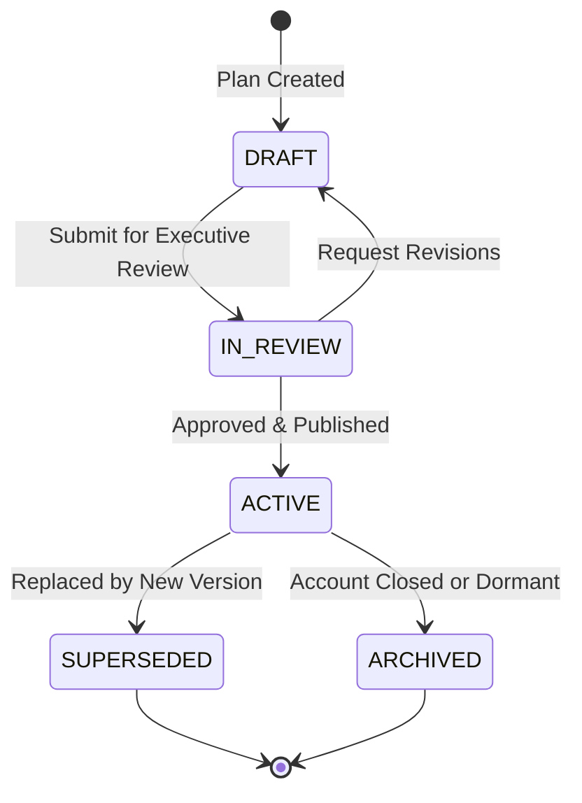

# Strategic Account Plans & Lifecycle Governance

## Overview

In FlowForge Automation SaaS Phase 27, strategic accounts are governed through versioned, auditable `CustomerAccountPlan` and `CustomerAccountPlanVersion` records. Account plans move through formal approval stages, enforce objective tracking, and capture immutable point-in-time snapshots of the customer's technical architecture, strategic intent, and committed milestones.

---

## 1. Account Plan Lifecycle State Machine

Account plans follow a strict finite state machine (FSM):

### Allowed Transitions:
- `DRAFT` -> `IN_REVIEW`, `ARCHIVED`
- `IN_REVIEW` -> `ACTIVE`, `DRAFT`, `ARCHIVED`
- `ACTIVE` -> `SUPERSEDED`, `ARCHIVED`
- `SUPERSEDED` -> `ARCHIVED`

---

## 2. Versioning & Immutable Snapshots

When a strategic account plan is modified or approved into a new release version:
1. A new `CustomerAccountPlanVersion` is created with an incremented version number (`v1`, `v2`, etc.).
2. The full plan content, current quantified business objectives, active blockers, milestones, and stakeholder roster are serialized into `snapshotData` (JSON).
3. The snapshot is marked with `publishedAt` and `publishedByUserId` for complete historical auditability.
4. Historical versions can be retrieved at `/account-planning/plans/:id/versions` to inspect exact account conditions during past quarters.

---

## 3. Strategic Account Classification Matrix

Every account can be configured with a strategic profile (`CustomerStrategicAccountProfile`):
- **Strategic Tier**: `STRATEGIC_TIER_1`, `STRATEGIC_TIER_2`, `GROWTH_TIER`, `SCALED_TIER`
- **Ownership Roles**:
  - `executiveSponsorUserId`: FlowForge executive providing high-level escalation and alignment.
  - `leadCsmUserId`: Customer Success Manager driving day-to-day value realization.
  - `accountDirectorUserId`: Commercial owner managing expansion and contract terms.
- **Cadence & Review Requirements**:
  - `ebrCadenceMonths`: Default `QUARTERLY` (3 months), `SEMI_ANNUAL` (6 months), or `ANNUAL` (12 months).
  - `lastEbrCompletedAt` & `nextEbrScheduledAt`: Automated tracking of overdue reviews.
