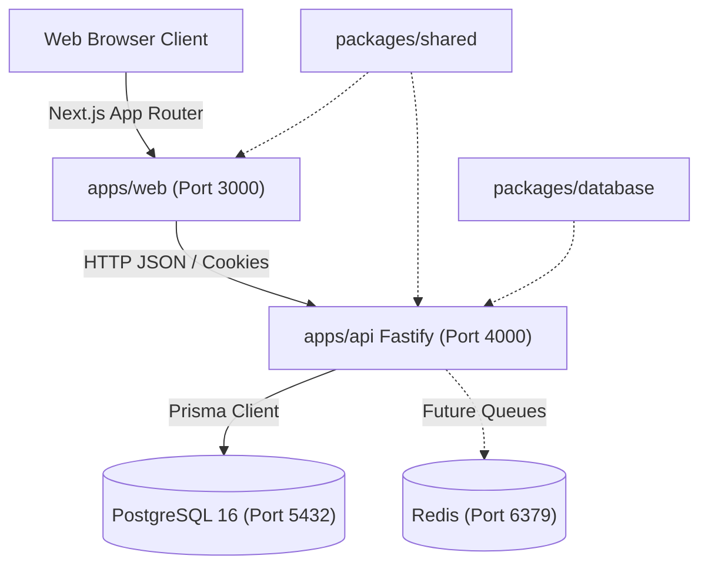

# FlowForge Automation — Architecture & System Design Documentation

## 1. System Overview
**FlowForge Automation** is an extensible workflow automation platform inspired by IFTTT, n8n, Make, and Zapier. Phase 1 provides the core foundation:
- **Client Frontend (`apps/web`)**: Next.js 14 App Router, React 18, Tailwind CSS, `@xyflow/react` (React Flow) canvas editor, TanStack Query, React Hook Form, and Zod.
- **REST API Backend (`apps/api`)**: Fastify with TypeScript, `/api/v1` routes, OpenAPI (Swagger UI) documentation, JWT session authentication via HttpOnly cookies, and strict tenant-aware database queries.
- **Data & Persistence Layer (`packages/database`)**: PostgreSQL 16 managed with Prisma ORM, versioned migrations, and automated database seeds.
- **Shared Type Safety (`packages/shared`)**: Shared Zod schemas, contract DTOs, DAG validation algorithms, and single-source branding configuration.



---

## 2. Monorepo Organization
The repository uses npm workspaces:
```
├── apps/
│   ├── api/                 # Fastify REST API server (/api/v1)
│   └── web/                 # Next.js 14 App Router visual canvas & dashboard
├── packages/
│   ├── database/            # Prisma schema, migrations, seed runner
│   └── shared/              # Zod validation schemas, types, app config, graph algorithms
├── infra/
│   └── docker-compose.yml   # PostgreSQL 16 and Redis services
├── docs/
│   └── architecture.md      # Architecture documentation
└── e2e/
    └── smoke.spec.ts        # Playwright desktop & mobile smoke suite
```

---

## 3. Data Modeling & Trade-offs

### Graph Representation in PostgreSQL
In Phase 1, `WorkflowVersion` stores the React Flow `nodes`, `edges`, and `viewport` directly as validated JSON columns (`JSONB` in PostgreSQL), alongside version integers and validity flags:
- **Trade-off Analysis**:
  - *Normalized Rows Approach*: Storing each node and edge as individual relational database rows requires dozens of inserts/updates per canvas autosave and complex multi-join tree assembly queries.
  - *Validated JSON Representation (Chosen)*: Allows atomic snapshots on every version, rapid client graph rendering, and flexible node data payloads. Deep graph validation (cycle detection, trigger checks) is strictly enforced in code before persisting.
  - *Phase 2 Execution Readiness*: When the execution engine runs, it traverses the directed graph using the validated `edges` adjacency matrix and logs individual step records in the normalized `WorkflowStepExecution` table.

---

## 4. Directed Acyclic Graph (DAG) Validation Algorithm
Workflows strictly reject cycles to avoid infinite runaway loops during execution:
1. **Trigger Check**: Verifies at least one `TRIGGER` node exists.
2. **Cycle Detection (DFS)**: Builds an adjacency list from `edges`. Traverses nodes using a recursive Depth-First Search with an active recursion stack set. If an edge points to an ancestor node currently in the stack, a `CYCLE_DETECTED` error is reported with the exact loop path.
3. **Self-Loop Check**: Immediate rejection if `edge.source === edge.target`.
4. **Disconnected Nodes**: Generates non-blocking warnings if loose nodes are detected.

---

## 5. Security & Multi-Tenancy Architecture
- **Tenant Scoping**: Every workflow, version, connection, and execution is strictly scoped by `workspaceId`.
- **Server-Side Authorization**: API routes decode the user's active session and check that the targeted workflow belongs to `request.authUser.workspaceId`.
- **Secret Redaction**: Connected external credentials are never returned in plain text via the API.
- **Passwords**: Hashed with PBKDF2 with 10,000 SHA-512 iterations and a cryptographically secure 16-byte random salt.

---

## 6. Phase 2 Deferred Features
The following features are intentionally deferred to Phase 2:
- BullMQ worker queues and worker execution loops.
- Live external OAuth2 callbacks for third-party providers (Slack, Google, Gmail).
- Incoming webhook event ingestion endpoints.
- Cron trigger scheduling engine.
- Stripe subscription billing and usage quotas (deferred to Phase 3).
