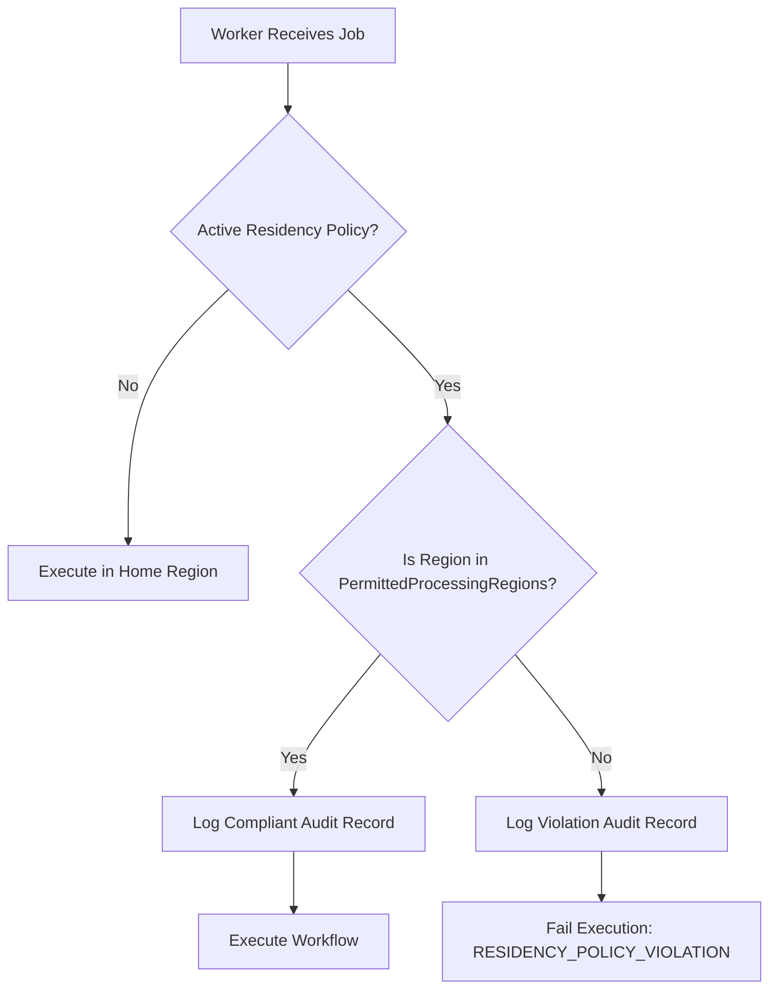

# FlowForge Automation SaaS — Phase 17 Data Residency & Compliance Governance

## 1. Overview & Policy Architecture

FlowForge Automation provides global enterprise tenants with **server-authoritative Data Residency Boundaries**, observable verification, and legal-hold-aware lifecycle governance.

### Architectural Tenets:
1. **Server-Authoritative Policy**: Data residency rules are defined at the workspace boundary (`WorkspaceResidencyPolicy`), enforced strictly by the backend execution engine and database tiers.
2. **Deterministic Region Fencing**: If a workflow execution is directed to a worker cluster in an unpermitted region, execution dispatch is rejected before processing mutations occur.
3. **Continuous Placement Verification**: An observable endpoint (`POST /api/v1/residency/verify`) continuously inspects topology and placement, recording verifiable evidence records.
4. **Legal-Hold Precedence**: Legal hold policies strictly override automated and manual deletion routines, preserving records for ongoing legal or regulatory inquiries.

---

## 2. Policy Model & Permitted Regional Sets

Each workspace is configured with a `WorkspaceResidencyPolicy`:
- **`homeRegion`**: Primary region where workspace tenant records and databases reside (e.g. `eu-central-1`, `us-east-1`).
- **`permittedProcessingRegions`**: Array of allowed compute zones where workflow execution runner workers are authorized to execute.
- **`permittedStorageRegions`**: Array of regions authorized for database tables, execution payloads, and artifacts.
- **`permittedBackupRegions`**: Array of regions authorized for encrypted snapshot archives and disaster recovery drills.
- **`crossRegionReplicationAllowed`**: Boolean enforcing strict data boundaries. When `false`, asynchronous cross-region replication is prohibited.
- **`status`**: `"ACTIVE"`, `"PENDING_REVIEW"`, or `"NON_COMPLIANT"`.

---

## 3. Boundary Enforcement in Execution Engine

When a workflow execution job is dispatched:
1. Runner loads workflow version and associated `WorkspaceResidencyPolicy`.
2. Runner determines execution worker region: `currentRegion = process.env.FLOWFORGE_REGION || "us-east-1"`.
3. If `residencyPolicy.status === "ACTIVE"`:
   - Validates whether `permittedProcessingRegions.includes(currentRegion)`.
   - If **Permitted**: Execution proceeds normally. A compliant `ResidencyAuditRecord` is logged.
   - If **Prohibited**: Runner immediately rejects execution with status `FAILED`, sets `errorSummary: RESIDENCY_POLICY_VIOLATION`, and logs a violation in `ResidencyAuditRecord`.

---

## 4. Legal Hold & Retention Lifecycle

FlowForge enforces multi-tiered data retention periods for executions, webhooks, and audit logs while providing strict legal hold protections:

### Legal Hold Operational Rules:
1. **Purge Protection**: When `legalHold: true`, automated cron jobs and manual administrative purges (`cleanupExpiredData`) are blocked from deleting any records for that workspace.
2. **Audit & Evidence Tracking**: Any blocked purge attempt generates an auditable `ComplianceEvidenceRecord` with scope `"PURGE_CYCLE"` and reason `"RETENTION_PURGE_BLOCKED"`.
3. **Dry-Run Simulation**: Operators and compliance auditors can execute dry-run purges (`dryRun: true`) to forecast candidate record counts without mutating persistence.
4. **Deliberate Deletion Block**: Complete workspace deletion requests (`requestWorkspaceDeletion`) are rejected when an active legal hold is in place.
