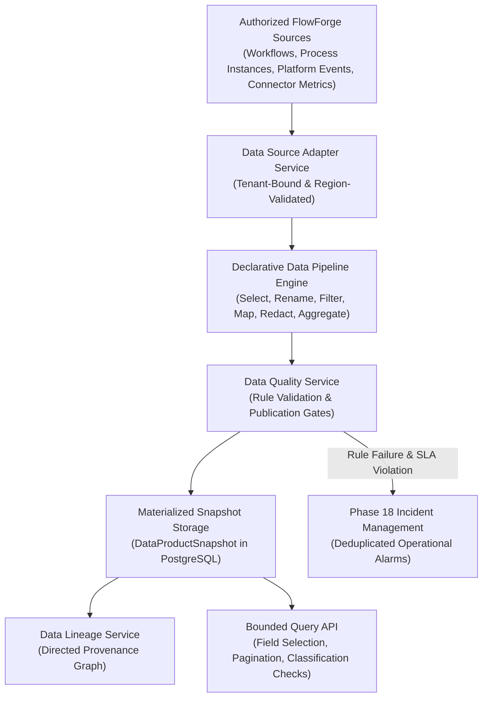

# FlowForge Data Intelligence Platform — Architecture Guide

## 1. Overview & Core Philosophy

The FlowForge Data Intelligence Platform establishes a governed data mesh layer directly on top of FlowForge Automation's operational infrastructure. 

> **Core Platform Principle**:  
> *"Every governed data product must have a defined owner, a documented schema, traceable lineage, measurable quality, explicit access controls, and an auditable lifecycle."*

Rather than introducing an unmanageable external data warehouse, the platform leverages PostgreSQL-backed materialized snapshots, versioned JSON records, safe declarative transformation pipelines, and strict tenant boundaries.

---

## 2. Architecture & Data Flow



---

## 3. Data Product Lifecycle & Governance

Data products transition through strict lifecycle states:

```
[DRAFT] ---> [IN_REVIEW] ---> [PUBLISHED] ---> [DEPRECATED] ---> [RETIRED]
```

- **`DRAFT`**: Schema and pipeline modifications can be iterated safely.
- **`IN_REVIEW`**: Stewards and owners review schema changes, diffs, and downstream impact.
- **`PUBLISHED`**: Version becomes completely immutable. Bound to canonical SHA-256 hash. Queries route to this active version.
- **`DEPRECATED`**: Existing consumers continue querying snapshots, but new dependencies are warned.
- **`RETIRED`**: Product is decommissioned. Queries are blocked.

### Canonical Schema Hashing & Evolution
Every schema version generates a deterministic SHA-256 content hash:
```ts
canonicalJsonStringify(schema) -> SHA-256 Digest
```
Compatibility diffing distinguishes:
- **Compatible additions**: Optional fields or fields with default values.
- **Breaking changes**: Field removals, data type shifts, or newly required properties. Breaking changes require administrative override (`isBreaking: true`) during draft versioning.
