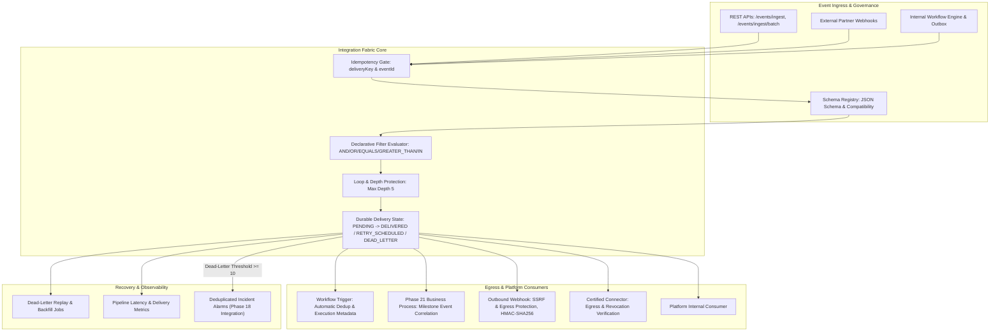

# FlowForge Enterprise Event-Driven Integration Fabric

## 1. Overview & Architecture

FlowForge Enterprise Event-Driven Integration Fabric (Phase 22) enables organizations to connect asynchronous workflows, cross-workflow business processes (Phase 21), certified connectors (Phase 19), external partner webhooks, and enterprise applications through reliable, tenant-isolated business events.

### Core Architectural Principle
Every business event has an immutable identity, tenant boundary, schema validation contract, declarative subscription routing policy, observable delivery state, and auditable outcome.



---

## 2. Canonical Business Event Envelope

All events ingested or emitted conform to the validated canonical envelope:

| Field | Type | Description |
|:---|:---|:---|
| `eventId` | `string` | Globally unique immutable identifier (`evt_...`). Generated if omitted. |
| `eventType` | `string` | Namespaced semantic identifier (e.g. `order.placed`, `payment.charged`). |
| `schemaVersion` | `integer` | Registered schema version number (defaults to active published version). |
| `source` | `string` | Originating component, connector, or API client. |
| `correlationId` | `string?` | End-to-end business correlation identifier. |
| `causationId` | `string?` | Immediate causal parent event ID. Evaluated for loop prevention. |
| `traceparent` | `string?` | W3C trace context header. |
| `subject` | `string?` | Business entity reference (e.g. `order_1001`, `customer_9901`). |
| `data` | `JSON` | Validated business event payload (max 512KB). |
| `metadata` | `JSON` | Non-sensitive contextual metadata. |
| `classification` | `enum` | `PUBLIC`, `INTERNAL`, `CONFIDENTIAL`, or `RESTRICTED`. |
| `deliveryKey` | `string?` | Client-provided idempotency key for safe retries. |
| `occurredAt` | `DateTime` | Source event timestamp. |
| `recordedAt` | `DateTime` | Server ingestion and persistence timestamp. |

---

## 3. Schema Registry & Compatibility Governance

Event types are registered in the workspace schema catalog.
- **Draft Schemas**: Mutable during design.
- **Published Schemas**: Cryptographically immutable with canonical SHA-256 content hashes.
- **Compatibility Modes**:
  - `BACKWARD`: New schema version can read events produced by previous schema version. Disallows adding new required fields without default values.
  - `FORWARD`: Previous schema version can read events produced by new schema version. Disallows removing previously required fields.
  - `FULL`: Enforces both backward and forward compatibility.
  - `NONE`: No compatibility enforcement.
- **Administrative Override**: Breaking changes require explicit `isBreaking: true` flag.

---

## 4. Declarative Subscriptions & Filter Engine

Subscriptions route events matching configured criteria to destinations.

### Filter Expressions
Filters use safe, deterministic JSON AST evaluation without dynamic code execution:
```json
{
  "operator": "AND",
  "conditions": [
    { "field": "data.amount", "operator": "GREATER_THAN", "value": 100 },
    { "field": "data.currency", "operator": "EQUALS", "value": "USD" },
    { "field": "source", "operator": "IN", "value": ["shopify", "stripe"] }
  ]
}
```

### Destination Routing
1. **Workflow Trigger (`WORKFLOW_TRIGGER`)**:
   - Triggers workflow execution only if workflow is `ACTIVE`.
   - Injects execution metadata: `{ triggerSource: "EVENT_SUBSCRIPTION", eventId, subscriptionId }`.
   - Prevents duplicate workflow execution launches for repeated event deliveries.
2. **Business Process Milestone (`PROCESS_MILESTONE`)**:
   - Forwards event directly to Phase 21 `ProcessInstanceService.ingestEvent`.
   - Maps correlation keys to process instances deterministically with deduplication.
3. **Outbound Webhook (`OUTBOUND_WEBHOOK`)**:
   - Validates destination URLs against SSRF vulnerabilities (loopback, link-local, private networks, cloud metadata addresses).
   - Generates HMAC-SHA256 signature header (`X-FlowForge-Signature: sha256=...`) if `signingSecret` is configured.
4. **Connector Action (`CONNECTOR_ACTION`)**:
   - Verifies connector artifact is `PUBLISHED` or `ACTIVE` and not `SUSPENDED` or `REVOKED`.

---

## 5. Delivery States, Dead-Letter & Replay

Deliveries transition deterministically through:
`PENDING` $\rightarrow$ `DELIVERED` or `RETRY_SCHEDULED` (with exponential backoff) $\rightarrow$ `DEAD_LETTER`.

- **Loop Protection**: Causation depth exceeding 5 halts immediately and marks delivery `DEAD_LETTER` with `LOOP_PROTECTION` error category.
- **Replay Jobs**: Controlled, quota-aware replay jobs allow re-delivering dead-letter events individually or in batches with dry-run estimation.

---

## 6. TypeScript SDK Example

```typescript
import { FlowForgeClient } from "@flowforge/sdk";

const client = new FlowForgeClient({ apiKey: "ffk_live_test123" });

// 1. Ingest event
const res = await client.events.ingest({
  eventType: "order.placed",
  source: "com.merchant.checkout",
  correlationId: "ord_1001",
  data: {
    orderId: "1001",
    amount: 250,
    currency: "USD",
  },
});
console.log("Event accepted:", res.data.eventId);

// 2. Query deliveries
const deliveries = await client.events.listDeliveries({ status: "DEAD_LETTER" });
for (const d of deliveries.data.items) {
  console.log(`Replaying dead letter: ${d.id}`);
  await client.events.replayDelivery(d.id);
}
```
