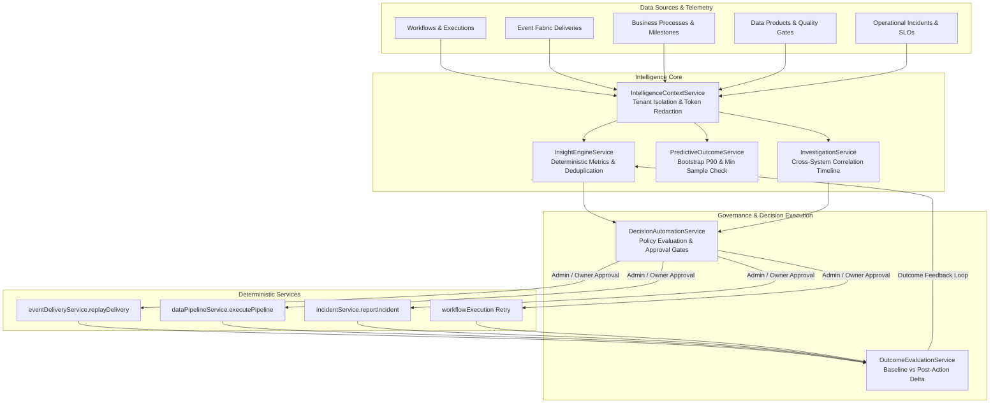

# FlowForge Automation SaaS — Phase 24 Architecture

## Enterprise AI Intelligence, Evidence-Grounded Decision Support & Governed Automation

Phase 24 establishes an enterprise-grade AI decision support and automated operational intelligence layer that turns operational telemetry, cross-workflow processes, event deliveries, data products, and execution history into evidence-backed insights, statistical forecasts, and policy-governed automated actions.

---

## 1. Core Architectural Axiom

> **"AI may explain evidence, estimate future outcomes, and recommend actions. Deterministic FlowForge services must validate policies and permissions before any action is approved or executed."**

AI models (and heuristic analytics engines) never directly execute arbitrary code, shell commands, or unvetted mutations. All actions route through allowlisted deterministic services (`eventDeliveryService`, `dataPipelineService`, `incidentService`, `workflowExecution`) after verifying caller permissions and preconditions.

---

## 2. Component Architecture

---

## 3. Data Model Summary

Phase 24 introduces 7 Prisma entities in `packages/database/prisma/schema.prisma`:

1. **`IntelligenceWorkspace`**: Persistent domain-specific analysis workspace with scope filtering and target resource tracking.
2. **`BusinessInsight`**: Evidence-grounded operational finding across 8 categories (`WORKFLOW_RELIABILITY_REGRESSION`, `PROCESS_BOTTLENECK`, `SLA_BREACH_RISK`, `EVENT_DELIVERY_DEGRADATION`, `DATA_QUALITY_DETERIORATION`, `DATA_FRESHNESS_VIOLATION`, etc.) deduplicated via `correlationKey`.
3. **`ForecastRun`**: Statistically grounded outcome prediction (mean, standard deviation, 90th percentile, 95% confidence intervals) enforcing $n \ge 3$ records and returning explicit `INSUFFICIENT_DATA` status on sparse history.
4. **`RootCauseInvestigation`**: Multi-system anomaly correlation aggregating failed executions, dead letters, and process status into a chronological timeline with candidate hypotheses, contradictory evidence, and recommended next steps.
5. **`DecisionProposal`**: Reviewable proposal lifecycle (`DRAFT` $\to$ `VALIDATING` $\to$ `PENDING_APPROVAL` $\to$ `APPROVED` $\to$ `EXECUTING` $\to$ `SUCCEEDED` / `FAILED` / `REJECTED` / `EXPIRED`).
6. **`DecisionOutcomeEvaluation`**: Feedback loop comparing pre-action baseline to post-action telemetry to determine verdict (`IMPROVED`, `WORSENED`, `NEUTRAL`, `INSUFFICIENT_DATA`).
7. **`IntelligencePolicy`**: Workspace-level policy governing auto-approval risk thresholds, maximum daily decision executions, and allowlisted action types.

---

## 4. API Endpoints

- `GET /api/v1/intelligence/overview`: Unified operational context and metrics stream.
- `POST /api/v1/intelligence/workspaces`: Create domain-specific analysis workspace.
- `GET /api/v1/intelligence/workspaces`: List intelligence workspaces.
- `POST /api/v1/intelligence/insights/analyze`: Trigger evidence-grounded insight generation.
- `GET /api/v1/intelligence/insights`: List business insights with category/severity filtering.
- `PATCH /api/v1/intelligence/insights/:id/status`: Update insight state (`ACKNOWLEDGED`, `DISMISSED`, `RESOLVED`).
- `POST /api/v1/intelligence/forecasts/run`: Generate statistical forecast.
- `GET /api/v1/intelligence/forecasts`: List forecast runs.
- `POST /api/v1/intelligence/investigations`: Start root-cause timeline correlation.
- `GET /api/v1/intelligence/investigations`: List investigations.
- `POST /api/v1/intelligence/proposals`: Create governed decision proposal.
- `GET /api/v1/intelligence/proposals`: List proposals by status/action.
- `POST /api/v1/intelligence/proposals/:id/approve`: Role-gated approval (`ADMIN` / `OWNER`).
- `POST /api/v1/intelligence/proposals/:id/reject`: Reject decision proposal.
- `POST /api/v1/intelligence/proposals/:id/execute`: Deterministically execute approved proposal.
- `POST /api/v1/intelligence/outcomes/evaluate/:proposalId`: Closed-loop outcome evaluation.
- `GET /api/v1/intelligence/outcomes`: List outcome evaluations.
