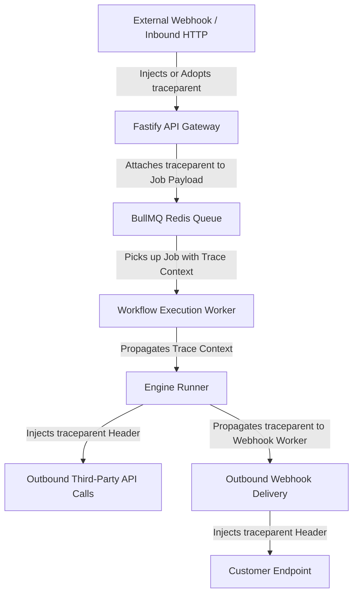

# Distributed Tracing Architecture & W3C Traceparent Propagation

## 1. Overview
FlowForge implements standard **W3C Trace Context (RFC standard)** to provide unbroken observability from external triggers all the way through background workers, runner sub-steps, third-party integration calls, and outbound webhooks.

Format:
```
traceparent: 00-${traceId}-${spanId}-01
```
- `00`: W3C Version
- `traceId`: 32-hex character global distributed trace identifier (16 bytes random)
- `spanId`: 16-hex character operation span identifier (8 bytes random)
- `01`: Traced flag

---

## 2. End-to-End Propagation Flow



1. **Inbound HTTP Request / Webhook**:
   - If an incoming `traceparent` header is present, FlowForge validates the format and adopts the `traceId`, generating a new child `spanId`.
   - If missing, a new W3C `traceparent` is created automatically.
2. **Queue Dispatch**:
   - The `traceparent` is stored in the BullMQ job data payload: `{ executionId, traceparent, ... }`.
3. **Execution Worker & Runner**:
   - The worker initializes the runner with the trace context.
   - The execution record is persisted with `traceparent` stored in the database.
4. **Third-Party Integrations**:
   - Outbound HTTP calls made by integrations and the HTTP Request node automatically include the `traceparent` header, allowing external microservices to link the trace.
5. **Outbound Webhooks**:
   - Customer-configured outbound webhook delivery jobs inherit the traceparent and inject the `traceparent` header in POST requests.
