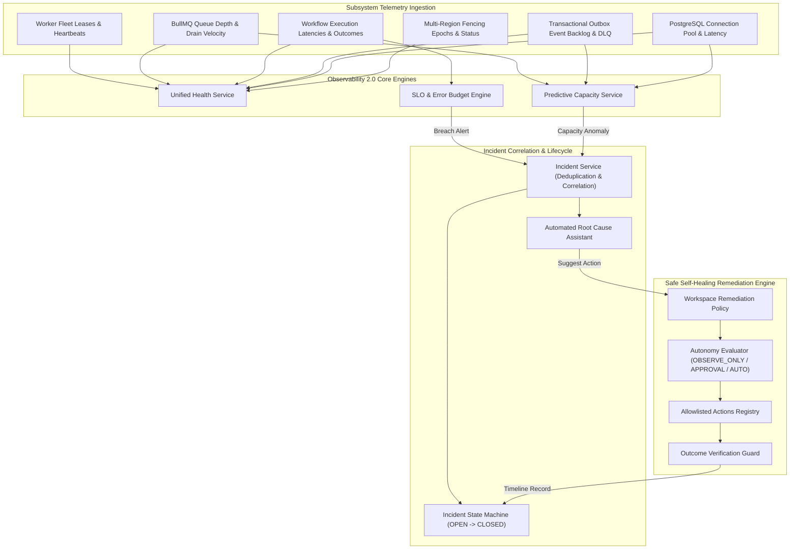
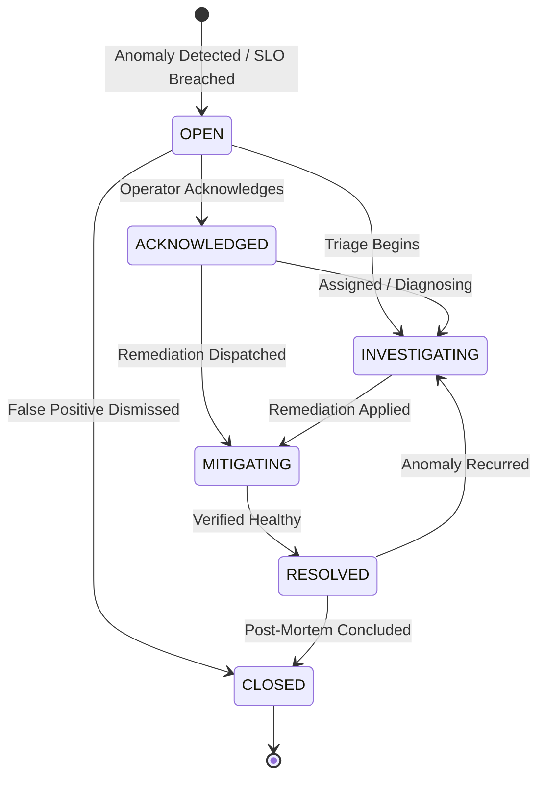

# FlowForge Automation SaaS — Observability 2.0 & Self-Healing Operations Architecture

## 1. Executive Summary

FlowForge Enterprise Observability 2.0 establishes an autonomous operational control plane designed for mission-critical SaaS orchestration. Building upon the multi-region foundation (Phase 16) and customer-managed encryption/residency boundaries (Phase 17), Observability 2.0 unifies telemetry across all distributed subsystems, enforces objective reliability targets (SLOs), correlates degradation signals into actionable incidents, and executes allowlisted self-healing remediations under strict, deterministic safety policies.

---

## 2. Architecture & Subsystem Topology

The platform provides a real-time, multi-dimensional health scorecard (`UnifiedHealthSummaryDTO`) synthesizing six fundamental architectural planes:

### 2.1 Subsystem Health Matrix
1. **Worker Fleet**:
   - Monitored metrics: Active worker count, heartbeat freshness (seconds), monotonic fencing lease validity.
   - Thresholds: Degraded if heartbeat freshness > 60s; Unavailable if > 180s.
2. **Execution Queues (BullMQ & Redis)**:
   - Monitored metrics: Queue depth (`waiting + active`), projected drain time (seconds), oldest waiting job age.
   - Thresholds: Degraded if depth > 500 or drain time > 90s; Unavailable if depth > 2000.
3. **Execution Engine**:
   - Monitored metrics: 24-hour success rate (%), P95 execution duration (ms), total completed vs failed.
   - Thresholds: Degraded if success rate < 95% or P95 > 5000ms; Unavailable if success rate < 80%.
4. **Transactional Outbox**:
   - Monitored metrics: Pending delivery count, dead-letter count (exhausted retries).
   - Thresholds: Degraded if DLQ > 0 or pending > 100; Unavailable if DLQ > 20 or pending > 1000.
5. **Database Storage (PostgreSQL & CMEK Layer)**:
   - Monitored metrics: Active connection count, pool saturation percentage, query round-trip latency.
   - Thresholds: Degraded if saturation > 80%; Unavailable if database is unresponsive.
6. **Regional Placement & Fencing**:
   - Monitored metrics: Primary authoritative region, active failover epoch, multi-region failover readiness.

---

## 3. SLO Engine & Error Budget Release Gates

### 3.1 Supported Reliability Objectives
- `SUCCESS_RATE`: Target percentage of workflow executions succeeding over the evaluation window (e.g., 99.0%).
- `P95_LATENCY`: Target 95th percentile duration of workflow steps/executions (e.g., < 1500ms).
- `MAX_DURATION`: Upper threshold for step execution timeouts (e.g., < 30000ms).
- `QUEUE_WAITING_TIME`: Target latency between trigger event ingestion and worker pickup (e.g., < 2500ms).

### 3.2 Error Budget Calculation
$$\text{Allowed Failure Rate} = 100\% - \text{Target Value}$$
$$\text{Actual Failure Rate} = 100\% - \text{Current Value}$$
$$\text{Error Budget Remaining} = \max\left(0, \frac{\text{Allowed Failure Rate} - \text{Actual Failure Rate}}{\text{Allowed Failure Rate}} \times 100\right)$$

- When remaining error budget falls below 25%, the objective enters `AT_RISK` status.
- When remaining error budget reaches 0%, status transitions to `BREACHED`.
- In release deployment pipelines, environments configured with `gateOnSloBreaches: true` block promotions when any workflow objective is in `BREACHED` status.

### 3.3 Cooldown & Deduplication
To prevent alert fatigue, when an SLO triggers an incident, a 30-minute alert cooldown (`alertCooldownUntil`) is enforced on the `ReliabilityObjective`.

---

## 4. Deterministic Incident Management

### 4.1 State Machine Lifecycle

### 4.2 Deduplication by Correlation Key
Every incident requires a deterministic `correlationKey` (e.g., `slo:<workspaceId>:<objectiveId>:BREACHED` or `integration:provider:status:<workspaceId>`).
- If an active incident with the correlation key exists in non-terminal status (`OPEN`, `ACKNOWLEDGED`, `INVESTIGATING`, `MITIGATING`), recurring triggers do not create duplicate incidents.
- An `ALERT_TRIGGERED` event with `{ deduplicated: true }` is appended to the incident's timeline, and `updatedAt` is refreshed.

### 4.3 Evidence-Backed Root Cause Assistant
The automated Root Cause Assistant analyzes real system telemetry upon incident creation or on-demand:
1. Inspects recent failed executions for affected workflows, parsing `errorSummary` for HTTP 429 rate limits, network timeouts, or schema invalidation.
2. Checks the transactional outbox for dead-letter backlog.
3. Formulates hypotheses with `evidenceStrength: "HIGH" | "MEDIUM" | "LOW"` and extracts concrete supporting evidence (e.g., execution IDs, error excerpts).
4. Recommends an allowlisted self-healing remediation action (`suggestedAction`).

---

## 5. Safe Self-Healing & Remediation Engine

### 5.1 The Safety Invariants
Automated operations must obey platform safety constraints:
1. **Allowlisted Actions Only**: Only registered, safe actions may ever be scheduled or run.
2. **Tenant Isolation**: Remediations operate strictly within the authenticated workspace.
3. **Residency & CMEK Immutability**: Self-healing never deletes customer data, never alters regional data residency boundaries, and never revokes or tampers with encryption keys.
4. **Physical Outcome Verification**: Operations do not claim success upon mere queueing; they must verify the actual target entity state (`VERIFIED` or `UNVERIFIED`).

### 5.2 Autonomy Modes
Every workspace configures a `RemediationPolicy`:
- `OBSERVE_ONLY` *(Default)*: Remediation actions are recommended and recorded as `PENDING_APPROVAL`, but never automatically executed.
- `APPROVAL_REQUIRED`: Actions require explicit human operator approval via REST API, Web UI, or TypeScript SDK.
- `POLICY_AUTOMATED`: Actions in `allowedActions` execute automatically, constrained by per-incident rate limits (default max 3) and cooldown periods (default 15 minutes).

### 5.3 Allowlisted Action Registry
| Action Key | Target Type | Action Behavior | Outcome Verification |
| :--- | :--- | :--- | :--- |
| `RETRY_RETRYABLE_EXECUTION` | `EXECUTION` | Spawns a retry execution with incremented attempt token and enqueues worker | Verifies child retry execution exists and is in `PENDING`, `RUNNING`, or `SUCCESS` |
| `REQUEUE_ABANDONED_JOB` | `QUEUE_JOB` | Clears stale worker leases and resumes execution from latest checkpoint | Verifies job is reconciled and active |
| `REPLAY_FAILED_OUTBOX_EVENT` | `OUTBOX_EVENT` | Resets dead-lettered outbox events to `PENDING` with retry backoff | Verifies event status is no longer `DEAD_LETTER` |
| `PAUSE_FAILING_DEPLOYMENT` | `WORKFLOW` / `DEPLOYMENT` | Deactivates failing workflow (`DRAFT`) or cancels rollout to protect production | Verifies target workflow status is not `ACTIVE` |
| `SCALE_CONCURRENCY_BACKPRESSURE` | `CONCURRENCY` | Throttles workspace concurrency cap to prevent upstream partner 429s | Verifies workspace `workloadPriority` is `THROTTLED` |

---

## 6. Predictive Capacity & Early Warning Telemetry

The `PredictiveCapacityService` tracks rolling telemetry to alert before outages occur:
- `QUEUE_AGE_SPIKE`: Oldest waiting job age exceeds baseline (30s threshold).
- `DRAIN_TIME_DETERIORATION`: Projected queue drain time exceeds 90s.
- `OUTBOX_ACCUMULATION`: Combined pending and dead-letter backlog exceeds 20 events.
- `WORKER_LEASE_SATURATION`: Worker concurrency pool exceeds 85% capacity.

Warnings are persisted as `OperationalCapacityWarning` records, updated idempotently while active, and automatically resolved when telemetry returns within baseline tolerances.
