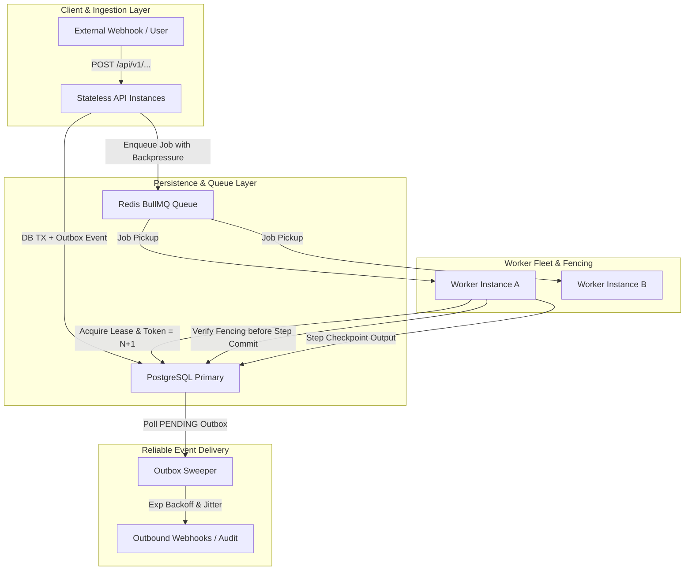

# High Availability & Reliability Architecture

## 1. Overview & Single-Region Docker Baseline

FlowForge Automation SaaS is deployed primarily as a high-density, multi-container architecture using Docker Compose (`docker-compose.prod.yml`).

### Realistic Architectural Boundaries
- **Deployment Topology**: Single-host active deployment with isolated containers for API (`flowforge-prod-api`), Worker (`flowforge-prod-worker`), Web UI (`flowforge-prod-web`), PostgreSQL 16 Alpine, and Redis 7 Alpine.
- **Truth in Advertising**: While the platform's distributed services (stateless API, Redis BullMQ queues, worker fencing tokens) are horizontally scalable across clustered instances, the local Docker Compose deployment does **not** provide multi-region failover or automated cloud database failover. Multi-region disaster recovery requires cloud infrastructure replication (e.g., AWS RDS Aurora Multi-AZ with cross-region read replicas).

---

## 2. Core Reliability Mechanisms



### 2.1 Worker Leasing & Monotonically Increasing Fencing Tokens
1. **Ownership**: Each worker instance generates a unique worker identifier (`worker_<pid>_<uuid>`).
2. **Lease Acquisition**: When picking up an execution job, the worker executes an atomic update:
   ```sql
   UPDATE workflow_executions
   SET leaseOwner = :workerId, leaseToken = leaseToken + 1, leaseExpiresAt = :now + 30s, status = 'RUNNING'
   WHERE id = :executionId
     AND status IN ('PENDING', 'RUNNING', 'WAITING_APPROVAL')
     AND (leaseExpiresAt IS NULL OR leaseExpiresAt < :now OR leaseOwner = :workerId);
   ```
3. **Fencing Invariant**: Any intermediate step commit or final completion state transition verifies that `WorkflowExecution.leaseToken` matches the worker's acquired token. If a worker paused (e.g., during garbage collection or network delay) and its lease expired, any attempt to commit state after another worker has taken over is strictly rejected, preventing split-brain corruption.

---

## 3. Recovery Objectives (RTO & RPO)

| Dimension | Target | Measurement & Guarantee |
| :--- | :--- | :--- |
| **Worker Crash Failover (RTO)** | < 30 seconds | Time for lease expiration and reconciler re-enqueuing. |
| **Execution Recovery Loss (RPO)** | 0 completed steps | Resumption from `lastCheckpointNodeId`; completed steps are never re-executed. |
| **Outbox Delivery Lag** | < 5 seconds | Real-time sweeping with exponential backoff before dead-letter queue. |
| **Database Disaster Recovery (RTO)** | < 5 minutes | Time to unpack verified backup and restore into isolated target. |
| **Database Data Point (RPO)** | < 1 hour | Periodic WAL archiving + snapshot verification. |
