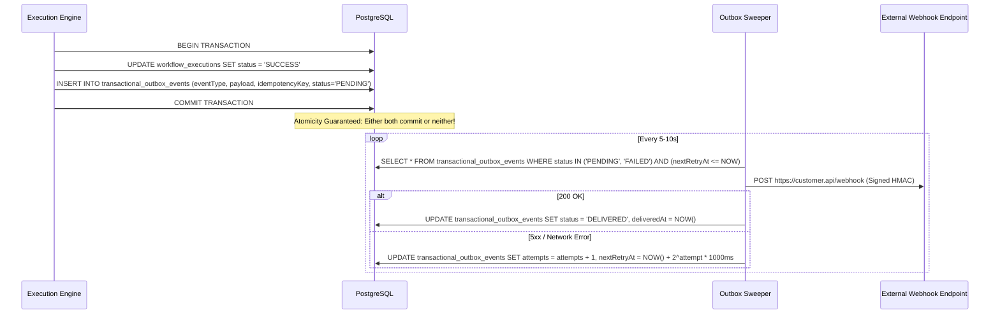

# Transactional Outbox Pattern & Reliable Event Delivery

## 1. Problem Statement & Dual-Write Avoidance

In distributed systems, executing a database state transition (e.g. marking a workflow execution `SUCCESS` or promoting a release) and immediately emitting an asynchronous event (e.g. HTTP webhook, audit trail, Kafka message) out-of-band introduces a critical dual-write failure mode:
1. **Database Commits, Network Fails**: The workflow succeeds in PostgreSQL, but the outbound webhook call crashes. The external client never receives the notification.
2. **Network Succeeds, Database Rollback**: The external webhook is called, but the database transaction rolls back, producing ghost side effects.

---

## 2. Solution: The Transactional Outbox Pattern

FlowForge solves this through `TransactionalOutboxEvent`:



---

## 3. Dead-Letter Queue & Operator Replay

Events that exceed `maxAttempts` (default 5 attempts) transition into `status = 'DEAD_LETTER'`:
- **Alerting**: Displayed immediately in the `/operations` dashboard.
- **Admin Replay API**: Authorized workspace administrators can safely trigger bulk replay:
  ```bash
  curl -X POST http://localhost:4000/api/v1/operations/outbox/replay \
    -H "Authorization: Bearer <ADMIN_JWT>" \
    -H "Content-Type: application/json" \
    -d '{"limit": 50}'
  ```
