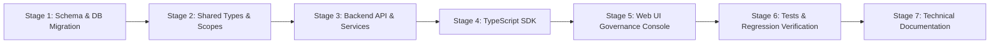

# FlowForge Automation SaaS — Phase 14 Implementation Plan
## Enterprise Collaboration, Organization-Wide Governance, Advanced Access Control, and Operational Intelligence

**Author:** Principal Software Architect, Senior Full-Stack Engineer, Security Engineer, QA Lead  
**Date:** October 23, 2026  
**Status:** APPROVED FOR IMPLEMENTATION  

---

## 1. Existing Architecture & Reusable Components

FlowForge Automation has successfully completed Phases 1–13. The following architectural components are in active production and will be directly reused/extended:

1. **Authentication & Identity (`apps/api/src/plugins/auth.ts`, `apps/api/src/services/sessions.ts`)**:
   - Multi-tenant JWT session verification, token revoking, and API key verification (`ffk_...`).
   - Workspace membership roles (`OWNER`, `ADMIN`, `MEMBER`) and scope enforcement.
   - Enterprise OIDC SSO (`WorkspaceSsoProvider`) and SCIM 2.0 provisioning (`ScimProvisioningToken`).
2. **Environments, Releases, & Deployments (Phase 12)**:
   - Isolated environments (`DEVELOPMENT`, `STAGING`, `PRODUCTION`), SHA-256 hashed immutable release artifacts (`WorkflowReleaseArtifact`), pre-deployment test gates (`WorkflowTestCase`, `WorkflowTestRun`), and approval policies (`DeploymentPolicy`).
3. **Governance & Audit Logs (Phase 9)**:
   - `WorkspaceGovernancePolicy` with HTTPS webhook enforcement, API key lifetime, and custom integration restrictions.
   - `WorkspaceAuditLog` with structured actor, action, target, and metadata logging.
   - Data export and GDPR deletion flows (`DataExportRequest`, `WorkspaceDeletionRequest`).
4. **Operations & Reliability Telemetry (Phase 10 & 11)**:
   - Background execution reconciliation (`reconciliationService`), queue metrics, usage intelligence, and in-app notifications (`notificationService`).
5. **AI Subsystem (Phase 13)**:
   - Deterministic service boundaries: *"AI proposes; deterministic FlowForge services validate and execute."*
   - Strict server-side secret scrubbing (`redactSensitiveData`) and tenant quota gating.

---

## 2. Organization, Team, & Resource-Ownership Design

### 2.1 Organization Model (`Organization`, `OrganizationMembership`)
- Allows multi-workspace enterprises to manage central policies, view aggregate reliability, and group workspaces.
- Backward compatibility: Workspaces optionally link via `organizationId: String?`. Standalone workspaces operate identically without breaking changes.
- Roles: `OWNER` (full billing, organization policies, workspace assignment), `ADMIN` (team and membership administration), `MEMBER` (collaborator).
- Invariant: At least one active `OWNER` must exist at all times; owner removal or demotion of the final owner is blocked server-side.

### 2.2 Team Management (`Team`, `TeamMember`)
- Teams exist within workspaces/organizations to group operators (e.g. "DevOps", "Finance Automation", "Growth Marketing").
- Roles: `LEAD` (team stewardship and permission management), `MEMBER` (participant).
- Teams can be assigned as workflow owners (`Workflow.owningTeamId`) or granted resource-level permissions.
- Lifecycle: `ACTIVE` or `ARCHIVED`. Archived teams immediately lose resource access; no stale permissions persist.

### 2.3 Workflow Ownership & Stewardship Metadata
Workflows are enriched with accountable operational metadata:
- `ownerUserId`: Accountable individual owner.
- `owningTeamId`: Owning functional team.
- `stewardUserId`: Designated secondary contact / technical steward.
- `criticality`: `TIER_1_CRITICAL`, `TIER_2_CORE`, `TIER_3_STANDARD`, `TIER_4_LOW`.
- `businessDomain`: Functional classification (e.g., "Billing", "Data Ingestion").
- `lifecycleStatus`: `DRAFT`, `ACTIVE`, `UNDER_REVIEW`, `DEPRECATED`, `ARCHIVED`.
- `nextReviewDate`: Periodic compliance re-certification timestamp.
- `escalationContact`: PagerDuty, Slack alias, or emergency runbook URL.

---

## 3. Authorization & Permission Inheritance

### 3.1 Resource-Level Access (`ResourcePermission`)
Fine-grained authorization extends beyond coarse workspace roles. Explicit grants can be made to users or teams on specific resources (`WORKFLOW`, `ENVIRONMENT`, `FOLDER`):
- Supported actions: `VIEW`, `EDIT`, `RUN`, `APPROVE`, `DEPLOY`, `MANAGE_PERMISSIONS`.
- Resolution Precedence:
  1. **Workspace Owner / Admin**: Superuser override for tenant management.
  2. **Direct User Grant**: Explicit `ResourcePermission` on user.
  3. **Team-Inherited Grant**: Effective actions granted through any active team membership.
  4. **Workflow Owner / Steward**: Grants `VIEW`, `EDIT`, `RUN` by default (does not bypass governance or deployment gates).
  5. **Default Workspace Role**: Standard read-only or member defaults.
- Revocation: Deleting a `ResourcePermission` or removing a user from a `Team` takes effect immediately on subsequent requests.

---

## 4. Collaborative Workflow Review & Change Approval

### 4.1 Review Lifecycle (`WorkflowReview`, `WorkflowReviewComment`)
- Collaborative change control operates before production promotion or workflow activation:
  - States: `SUBMITTED` -> `CHANGES_REQUESTED` -> `APPROVED` | `REJECTED` | `SUPERSEDED`.
  - Immutable Content Binding: Each review is locked to an exact `contentHash` (SHA-256) of the reviewed graph.
  - Invalidation Rule: If an author modifies the draft after submission, the prior approval is automatically marked `SUPERSEDED`, preventing stale authorization replays.
  - Discussion: Node-specific and general review comments (`WorkflowReviewComment`) notify authors and reviewers via `notificationService`.
- Concurrency Control: Optimistic locking on workflow updates ensures simultaneous edits from multiple operators return HTTP `409 Conflict` with a diff preview, preventing silent overwrites.

---

## 5. Centralized Governance Policy Engine

### 5.1 Deterministic Policy Evaluator (`governanceService.evaluatePolicy`)
Extends `WorkspaceGovernancePolicy` with enterprise rule evaluations:
1. `REQUIRE_OWNER`: Workflows must have a defined `ownerUserId` or `owningTeamId` before activation or production promotion.
2. `REQUIRE_APPROVAL_FOR_TIER1`: `TIER_1_CRITICAL` workflows require an `APPROVED` `WorkflowReview` before promotion to protected environments.
3. `REQUIRE_PASSING_TESTS`: Automated test suite must pass in `DRY_RUN` mode prior to deployment.
4. `RESTRICT_PROHIBITED_INTEGRATIONS`: Disallows unapproved connectors in production graphs.
5. `MAX_EXECUTION_DURATION`: Flags workflows exceeding permitted timeout thresholds.
6. `REQUIRE_RETRY_BACKOFF`: Outbound HTTP nodes must have retry and backoff configured.

### 5.2 Enforcement Gateways
Policies are evaluated at actual operational choke points:
- `PATCH /workflows/:id/status` (Activation gate)
- `POST /deployments/promote` (Release promotion gate)
- `POST /workflows/:id/archive` (Archival gate)

---

## 6. Enterprise Audit Search & Compliance Evidence

### 6.1 Searchable Audit Stream (`GET /governance/audit-logs`)
- Filterable by date range (`startDate`, `endDate`), `actorId`, `targetType`, `action`, and keyword.
- Strict workspace isolation: Cross-tenant query leaks are prevented by indexing on `workspaceId`.

### 6.2 Compliance Export Pipeline (`ComplianceExportJob`)
- Generates bounded, downloadable audit evidence packages in JSON format.
- Security controls:
  - Sensitive tokens, passwords, and authorization headers are scrubbed using `redactSensitiveData()`.
  - Export packages expire automatically after 48 hours.
  - Downloads require an authenticated, single-use `downloadToken`.

---

## 7. Operational Intelligence, SLOs, & Error Budgets

### 7.1 Reliability Objectives (`ReliabilityObjective`)
- Quantifiable Service-Level Objectives (SLOs) defined per workflow or workspace-wide:
  - Metrics: `SUCCESS_RATE` (e.g., 99.5%), `P95_LATENCY` (e.g., 2000ms), `MAX_DURATION`.
  - Rolling Evaluation Windows: 7, 14, or 30 days.
  - Statistical Honesty: Requires a minimum sample size (>= 5 executions). Below this threshold, status is `INSUFFICIENT_DATA` rather than a false 100%.
  - Error Budget: `allowedFailures = totalEligibleExecutions * (1 - targetSuccessRate / 100)`.
- Deduplicated Alerting: Objective violations generate notifications with a 6-hour alert cooldown to prevent notification storms.

---

## 8. Implementation Sequence

1. **Database Schema**: Add `Organization`, `OrganizationMembership`, `Team`, `TeamMember`, `ResourcePermission`, `WorkflowReview`, `WorkflowReviewComment`, `ReliabilityObjective`, `ComplianceExportJob`. Extend `Workflow` and `WorkspaceGovernancePolicy`.
2. **Shared Package (`@flowforge/shared`)**: Define DTOs, schemas, and developer scopes (`"org:admin"`, `"governance:read"`, `"governance:write"`, `"reviews:write"`, `"slo:manage"`).
3. **Backend Services (`apps/api`)**:
   - `organizationService.ts`
   - `teamService.ts`
   - `permissionService.ts`
   - `reviewService.ts`
   - `reliabilityService.ts`
   - Extend `governanceService.ts` with deterministic policy evaluation.
   - Register routes under `/organizations`, `/teams`, `/permissions`, `/reviews`, `/reliability`, `/compliance`.
4. **TypeScript SDK (`packages/sdk`)**: Add `client.organizations`, `client.teams`, `client.permissions`, `client.reviews`, `client.reliability`, `client.compliance`.
5. **Frontend Console (`apps/web`)**: Build `/governance` dashboard featuring Teams, Ownership Intelligence, Reviews, Policies, Audit Search, and SLO Tracker.
6. **Testing**:
   - Vitest backend test suite (`apps/api/test/phase14.test.ts`).
   - SDK test suite (`packages/sdk/test/sdk.test.ts`).
   - Playwright E2E browser tests in `e2e/smoke.spec.ts`.
7. **Documentation**: Technical guides in `docs/` and `phase-14-completion-report.md`.

---

## 9. Security Threat Model & Defense-in-Depth

| Threat Vector | Mitigation Strategy |
| :--- | :--- |
| **Privilege Escalation** | Permission checks occur server-side in `permissionService.ts`. Users cannot grant permissions they do not possess. Demoting the final Organization Owner is rejected with HTTP 400. |
| **Cross-Tenant Ingestion** | All queries enforce `workspaceId = request.authUser.workspaceId`. Organization endpoints enforce `OrganizationMembership`. |
| **Stale Review Replay** | Reviews are bound to exact SHA-256 graph hashes. Any subsequent draft edit sets review status to `SUPERSEDED`. |
| **Secret Exfiltration via Audit Export** | Exports pass through `redactSensitiveData()` to scrub API keys, authorization headers, and credentials. Export downloads require authenticated tokens. |
| **Stale Team Permissions** | Archiving a team sets `status = "ARCHIVED"` and immediately zeroes effective permissions in `permissionService`. |

---

## 10. Acceptance Criteria

- [x] Baseline test verification established (244/244 API, 13/13 SDK, 72/72 Playwright passed).
- [ ] Organization & Team management functional with last-owner protection.
- [ ] Resource-level permissions (`ResourcePermission`) evaluated server-side.
- [ ] Workflows support ownership, stewardship, criticality, and lifecycle status.
- [ ] Ownership intelligence detects orphan, deprovisioned, and unreviewed workflows.
- [ ] Collaborative reviews bind to immutable content hashes; modifications supersede approvals.
- [ ] Deterministic governance evaluation blocks activation/promotion on policy breaches.
- [ ] Audit logs support multi-dimensional search; compliance exports generate securely.
- [ ] Reliability objectives evaluate real execution metrics with error budget tracking.
- [ ] All existing Phase 1–13 capabilities, environments, and tests remain 100% green.
