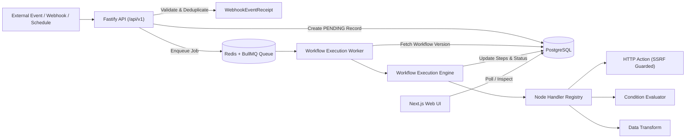

# FlowForge Automation — Phase 2 Implementation Plan: Real Workflow Execution Engine

## 1. Overview and Objectives
Phase 2 transitions FlowForge Automation from a visual scaffold into a production-grade, distributed workflow execution platform. Workflows authored in the visual React Flow editor will execute reliably in a background asynchronous worker process backed by PostgreSQL, Redis, and BullMQ.



---

## 2. Existing Architecture & Baseline
- **Frontend (`apps/web`)**: Next.js 14 App Router, React Flow (`@xyflow/react`), TanStack Query, Tailwind CSS.
- **Backend (`apps/api`)**: Fastify REST API with `/api/v1` routes, OpenAPI Swagger UI, JWT auth in HttpOnly cookies, tenant isolation.
- **Database (`packages/database`)**: PostgreSQL 16 with Prisma ORM (`User`, `Workspace`, `Workflow`, `WorkflowVersion`, `WorkflowExecution`, `WorkflowStepExecution`, `IntegrationDefinition`, `ConnectedAccount`).
- **Infrastructure (`infra`)**: PostgreSQL 16 on port 5432 and Redis 7 on port 6379 running via Docker Compose.
- **Shared Package (`packages/shared`)**: Shared Zod schemas, types, and DAG cycle detection algorithms.

---

## 3. Database Schema Extensions
Extend `packages/database/prisma/schema.prisma` with:
1. **`Workflow`**:
   - `webhookSlug String? @unique`: Unguessable unique slug for webhook triggering.
   - `webhookSecret String?`: Optional HMAC signature secret.
2. **`WebhookEventReceipt`**:
   - Tracks incoming webhook requests (`id`, `workflowId`, `eventId`, `sourceIp`, `headers`, `payload`, `processedAt`, `executionId`, `createdAt`).
   - Unique constraint `@@unique([workflowId, eventId])` for atomic deduplication.
3. **`WorkflowExecution`**:
   - Extended with `attempt Int @default(1)`, `maxAttempts Int @default(3)`, `retryOfId String?`, `correlationId String?`, `errorCategory String?`, `triggerPayload Json?`, `executionTrace Json?`, `nextRetryAt DateTime?`.
4. **`WorkflowStepExecution`**:
   - Extended with `attempt Int @default(1)`, `errorCategory String?`, `correlationId String?`.
5. **`ScheduledTrigger`**:
   - Dedicated table for scheduled workflows (`id`, `workflowId`, `cronExpression`, `timezone`, `nextRunAt`, `lastRunAt`, `status`, `jobId`, `createdAt`, `updatedAt`).

---

## 4. Queue & Worker Design
- **Technology**: BullMQ backed by the existing Redis 7 service.
- **Queue**: `workflow-execution` queue with bounded concurrency (default 5 concurrent jobs per worker replica).
- **Execution Lifecycle**:
  1. Incoming trigger validates workflow is `ACTIVE` and graph is valid.
  2. Persistent `WorkflowExecution` created in status `PENDING` inside a database transaction.
  3. BullMQ job enqueued with `{ executionId, workflowId, versionId, triggerPayload, correlationId }`.
  4. Worker picks up job, transitions status to `RUNNING`.
  5. Graph loaded from immutable `WorkflowVersion`.
  6. Topological execution step-by-step with dependency resolution and condition branch filtering.
  7. Step results persisted to `WorkflowStepExecution`.
  8. Final status updated to `SUCCESS` or `FAILED`.
  9. Graceful shutdown handling (`SIGTERM`/`SIGINT`) waiting for in-flight jobs to finalize.

---

## 5. Node Handler Registry & Supported Node Types
An extensible handler interface:
```typescript
export interface NodeHandler<TConfig = any, TInput = any, TOutput = any> {
  type: NodeType;
  validateConfig(config: TConfig): { isValid: boolean; errors: string[] };
  execute(context: ExecutionStepContext<TConfig, TInput>): Promise<NodeExecutionResult<TOutput>>;
}
```

### Supported Nodes:
1. **`TRIGGER` (Webhook & Schedule)**:
   - Webhook trigger emits `{ headers, query, body, rawBody, receivedAt, eventId }`.
   - Schedule trigger emits `{ scheduledTime, timezone, triggerType: "SCHEDULE" }`.
2. **`HTTP_REQUEST`**:
   - Real HTTP request using native `fetch` / `undici`.
   - SSRF protection: validates IP address via DNS lookup before connect; blocks private, loopback, and cloud metadata (169.254.169.254) addresses; revalidates redirect targets; timeout and response size limits.
   - Supports GET, POST, PUT, PATCH, DELETE.
   - Redacts authorization headers from step logs.
3. **`CONDITION`**:
   - Safe declarative rule evaluation: `equals`, `not_equals`, `greater_than`, `less_than`, `contains`, `not_contains`, `exists`, `is_empty`.
   - Controls branch traversal: activates downstream edges attached to handle `true` or `false`.
4. **`TRANSFORMATION` / `ACTION`**:
   - Safe expression interpolation (e.g. `{{trigger.body.id}}` or `{{steps.http_node.data.status}}`).
   - JSON path lookup without `eval` or `new Function`.
5. **`WORKFLOW_END`**:
   - Terminal node marking path completion with exit status.

---

## 6. Security Risks & Mitigations
- **SSRF (Server-Side Request Forgery)**: Strict IP blacklist blocking `127.0.0.0/8`, `10.0.0.0/8`, `172.16.0.0/12`, `192.168.0.0/16`, `169.254.0.0/16` (AWS/GCP metadata), IPv6 loopback (`::1`), link-local (`fe80::/10`). Redirects re-checked before following.
- **Cross-Tenant Access**: Every query and execution retry strictly filtered by `workspaceId`.
- **Credential Leakage**: Passwords, API keys, and authorization headers redacted before saving to `outputData` or logging.
- **Denial of Service / Runaway Loops**: Directed Acyclic Graph (DAG) validation rejects cycles. Step timeout (30s) and workflow max steps limit (50 steps).
- **Arbitrary Code Execution**: Zero usage of `eval`, `Function`, or child processes.

---

## 7. Testing Strategy
- **Unit Tests**:
  - SSRF validator & IP range checker.
  - Data mapping expression resolver.
  - Condition operators.
  - DAG execution step scheduler and branch filtering.
- **Integration Tests**:
  - Webhook ingestion, HMAC verification, and deduplication.
  - BullMQ queue submission and worker processing.
  - Trigger -> HTTP Request -> Condition -> End workflow execution.
  - Execution retry and cancellation.
  - Tenant isolation.
- **Playwright E2E Tests**:
  - Full end-to-end browser smoke tests: create webhook workflow, activate, trigger via webhook HTTP request, verify execution appears with completed steps in UI, verify logs and details.

---

## 8. Implementation Milestones
- **Milestone A**: Execution Data Model & Database Migrations.
- **Milestone B**: Node Handler Registry & SSRF Guard.
- **Milestone C**: BullMQ Queue & Dedicated Worker Process.
- **Milestone D**: Webhook Ingestion & Deduplication System.
- **Milestone E**: Durable Scheduling with BullMQ Repeatable Jobs.
- **Milestone F**: REST API Endpoints (Activate, Pause, Test, Retry, Cancel, Webhooks, Worker Health).
- **Milestone G**: Frontend UI Updates (Webhook details, test button, live polling execution history, retry button).
- **Milestone H**: Automated Testing, Browser Verification, and Documentation.
