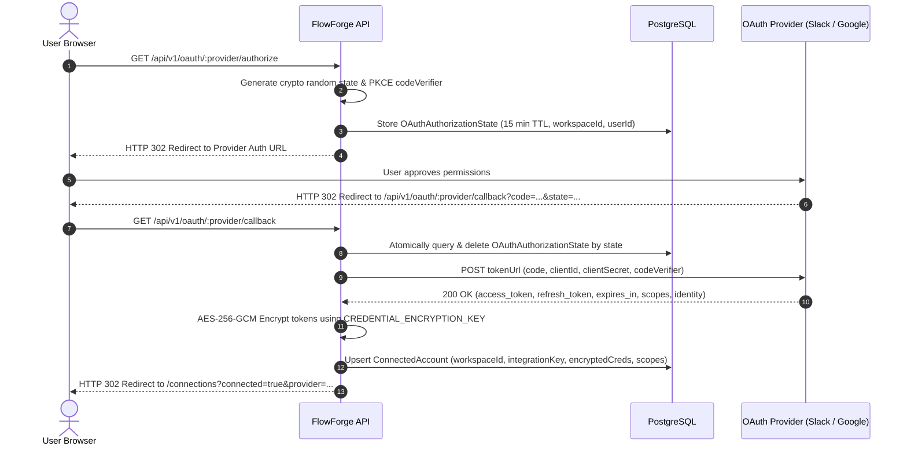

# Phase 3 Implementation Plan: Real Third-Party Integrations, OAuth, and Connected Accounts

## 1. Current Architecture Review

FlowForge Automation currently has:
- **Phase 1 Foundation:** Next.js frontend, Fastify REST API (`/api/v1`), PostgreSQL via Prisma ORM, JWT + cookie workspace authentication, visual canvas powered by `@xyflow/react`.
- **Phase 2 Runtime Engine:** BullMQ queue running on Redis 7, detached worker processes executing workflows with DAG topological traversal, public webhook ingestion with HMAC authentication and idempotency deduplication, durable cron scheduling, strict SSRF protection, safe expression evaluation (`{{trigger.body.x}}`), and step-level persistence with live polling and retry capabilities.
- **Existing Integration Seed:** Preliminary `IntegrationDefinition` records in PostgreSQL for `webhook`, `http-request`, `schedule`, `slack`, `google-sheets`, `google-drive`, `gmail`, and `discord`.
- **Existing Connected Accounts:** `ConnectedAccount` model with basic CRUD, currently returning sanitized fields.

---

## 2. Phase 3 Integration Architecture

### Extensible Integration Framework
Every integration implements the unified `IntegrationProvider` interface:
```ts
export interface IntegrationProvider {
  id: string; // "slack", "google", etc.
  name: string;
  description: string;
  iconName: string;
  category: "COMMUNICATION" | "PRODUCTIVITY" | "STORAGE" | "DEVELOPER";
  authType: "OAUTH2" | "API_KEY" | "NONE";
  oauthConfig?: {
    authorizationUrl: string;
    tokenUrl: string;
    scopes: string[];
    extraAuthParams?: Record<string, string>;
  };
  operations: IntegrationOperation[];
  testConnection?: (credentials: DecryptedCredentials) => Promise<{ ok: boolean; error?: string }>;
  refreshToken?: (refreshToken: string) => Promise<TokenRefreshResult>;
}
```

Operations declare input schemas, validation, and execution logic:
```ts
export interface IntegrationOperation {
  id: string; // e.g. "post_message", "append_row"
  name: string;
  description: string;
  type: "ACTION" | "TRIGGER";
  parameters: OperationParameter[];
  execute: (ctx: OperationExecutionContext) => Promise<OperationExecutionResult>;
}
```

---

## 3. Supported Integrations & Operations

### Integration A: Slack (`slack`)
- **Authentication:** OAuth 2.0 (Bot User OAuth Token) with authorization code flow.
- **Scopes:** `chat:write`, `channels:read`, `groups:read`, `chat:write.public`.
- **Action:** `post_message`
  - Parameters: `channel` (channel ID or name), `text` (markdown message), `asUser` (optional).
  - Variable interpolation: Safe Mustache syntax (`{{trigger.body.leadName}}`).
  - Channel helper endpoint: `GET /api/v1/integrations/slack/channels` using user's connected account.
  - Error classification: `AUTH_FAILURE`, `CHANNEL_NOT_FOUND`, `RATE_LIMIT` (HTTP 429 Retry-After), `SLACK_API_ERROR`.

### Integration B: Google Sheets (`google-sheets`)
- **Authentication:** Google OAuth 2.0 with offline access (refresh tokens).
- **Scopes:** `https://www.googleapis.com/auth/spreadsheets`.
- **Action:** `append_row`
  - Parameters: `spreadsheetId` (ID or URL), `range` (e.g. `Sheet1!A:Z`), `values` (array or JSON key-value map mapped to columns), `valueInputOption` (`USER_ENTERED` or `RAW`).
  - Variable interpolation: Supports dynamic values from prior steps.
  - Error classification: `AUTH_FAILURE`, `SPREADSHEET_NOT_FOUND`, `PERMISSION_DENIED`, `QUOTA_EXCEEDED`.

### Integration C: Gmail (`gmail`)
- **Authentication:** Google OAuth 2.0.
- **Scopes:** `https://www.googleapis.com/auth/gmail.send`.
- **Action:** `send_email`
  - Parameters: `to` (validated email address or comma-separated list), `subject`, `body` (plain text or validated HTML), `cc`, `bcc`.
  - Safety constraints: Strict recipient validation, side-effect explicit warning, idempotent execution tracking.
  - Error classification: `INVALID_RECIPIENT`, `QUOTA_EXCEEDED`, `AUTH_FAILURE`.

### Integration D: Google Drive (`google-drive`)
- **Authentication:** Google OAuth 2.0.
- **Scopes:** `https://www.googleapis.com/auth/drive.readonly`, `https://www.googleapis.com/auth/drive.metadata.readonly`.
- **Action:** `list_files`
  - Parameters: `query` (MIME type, folder ID, or name search), `pageSize` (1-100), `orderBy`.
- **Action:** `get_file_metadata`
  - Parameters: `fileId`, `fields` (name, mimeType, size, webViewLink, createdTime).
  - Error classification: `FILE_NOT_FOUND`, `AUTH_FAILURE`.

### Integration E: Reusable HTTP & Webhook Nodes
- Preserves existing Phase 2 implementations with strict SSRF protection, loopback/private IP blocking, and header redaction.
- Integrates with the Connected Accounts system so HTTP nodes can reference saved API keys or Bearer tokens.

---

## 4. OAuth 2.0 Security & Token Management



### Encryption at Rest
- **Algorithm:** `AES-256-GCM` with a 96-bit random IV (nonce) generated per operation and a 128-bit authentication tag.
- **Key Source:** `CREDENTIAL_ENCRYPTION_KEY` environment variable (32 bytes hex/base64).
- **Format:** `enc:v1:<iv_hex>:<tag_hex>:<ciphertext_hex>`.
- **Tenant Isolation:** All operations enforce `workspaceId` equality; accounts cannot be accessed across workspaces.
- **Redaction:** Tokens are never returned to frontend clients or serialized to execution logs.

### Automatic Token Refresh
- `TokenManager` checks `expiresAt`. If token is expired or within 5 minutes of expiration, it requests a new access token using the stored refresh token.
- Handles refresh-token rotation and sets connection status to `REVOKED` if the provider rejects the refresh token.

---

## 5. Database Schema Changes

```prisma
model ConnectedAccount {
  id             String    @id @default(uuid())
  workspaceId    String
  integrationKey String
  name           String
  credentials    Json      @default("{}") // AES-256-GCM encrypted
  metadata       Json      @default("{}") // Identity metadata (email, teamName, accountId)
  scopes         String[]  @default([])
  expiresAt      DateTime?
  status         String    @default("ACTIVE") // ACTIVE, EXPIRED, REVOKED, ERROR
  lastVerifiedAt DateTime?
  createdAt      DateTime  @default(now())
  updatedAt      DateTime  @updatedAt

  workspace Workspace @relation(fields: [workspaceId], references: [id], onDelete: Cascade)

  @@index([workspaceId])
  @@index([workspaceId, integrationKey])
  @@map("connected_accounts")
}

model OAuthAuthorizationState {
  id           String   @id @default(uuid())
  state        String   @unique
  provider     String
  workspaceId  String
  userId       String
  codeVerifier String?
  redirectUri  String?
  metadata     Json?
  expiresAt    DateTime
  createdAt    DateTime @default(now())

  @@index([state])
  @@index([workspaceId])
  @@map("oauth_authorization_states")
}
```

---

## 6. Testing Strategy

1. **Unit Tests:**
   - AES-256-GCM encryption/decryption round-trip and tamper detection.
   - OAuth state generation, PKCE verification, and TTL expiry.
   - Provider operation input validation and dynamic expression substitution.
   - Error classification mapping.
2. **Integration Tests (Mocked Providers):**
   - OAuth authorization code exchange & callback handling.
   - Token refresh lifecycle.
   - Slack `post_message` action with simulated Slack API.
   - Google Sheets `append_row` action with simulated Google Sheets API.
   - Gmail `send_email` action with simulated Gmail API.
   - Google Drive `list_files` and `get_file_metadata` with simulated Drive API.
   - Tenant isolation: User in Workspace A cannot access Workspace B's connections.
3. **Playwright E2E Smoke Tests:**
   - Connected Accounts page display and connection initiation.
   - Workflow editor canvas with third-party integration nodes.
   - Executing workflows with integration steps and verifying execution history diagnostics.

---

## 7. Implementation Milestones

- [x] **Milestone 1:** Architecture plan (`docs/phase-3-implementation-plan.md`) and database schema migration.
- [ ] **Milestone 2:** AES-256-GCM encryption service and OAuth state manager.
- [ ] **Milestone 3:** OAuth routes (`/api/v1/oauth/:provider/*`) and Connected Accounts management endpoints.
- [ ] **Milestone 4:** Slack integration provider & action execution handler.
- [ ] **Milestone 5:** Google integration providers (Sheets, Gmail, Drive) & action execution handlers.
- [ ] **Milestone 6:** Workflow engine integration with `defaultRegistry` and node config panel updates in UI.
- [ ] **Milestone 7:** Testing suite expansion (Vitest integration tests & Playwright E2E tests).
- [ ] **Milestone 8:** Verification, documentation, and completion report.
