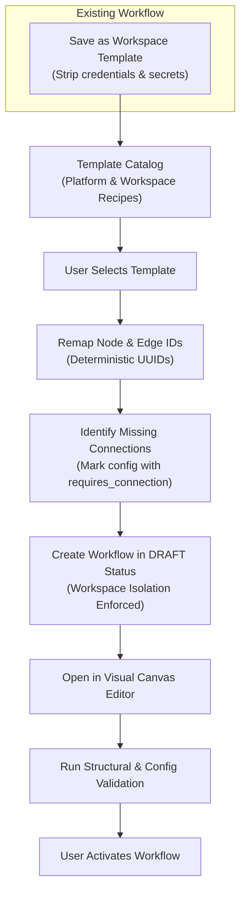

# FlowForge Automation SaaS — Phase 7 Master Implementation Plan
## Workflow Templates, Reusable Automation Recipes, Versioning, Import/Export, Onboarding, Collaboration, and Product Experience

### Date: October 2026
### Author: Principal Product Architect, Senior Full-Stack Engineer & Workflow Automation Specialist
### Status: APPROVED & IN IMPLEMENTATION

---

## 1. Executive Summary & Baseline Audit

### Existing Foundation (Phases 1–6)
- **Engine & Execution**: BullMQ + Redis async execution engine, execution history, retries, step trace logs, mid-run cancellation.
- **Integrations**: Slack, Google Sheets, Gmail, Google Drive, HTTP Request, Webhooks, Schedules, Approvals, Loops, Filters, Transforms.
- **Billing & Monetization**: Multi-tier plans (Free, Pro, Business), Stripe integration with mock fallback, server-authoritative entitlements, durable usage metering ledger.
- **Security & Multi-Tenancy**: Workspace-level data isolation, role-based access (OWNER, ADMIN, MEMBER), AES-256-GCM credential encryption, SSRF protection, Prometheus metrics, Rate Limiting, CSP headers.
- **Baseline Test Verification**:
  - Vitest: **118 passed / 118 total (100%)** across 6 test suites (`test/api.test.ts`, `test/execution.test.ts`, `test/integrations.test.ts`, `test/phase4.test.ts`, `test/security.test.ts`, `test/billing.test.ts`).
  - Playwright: **30 passed / 30 total (100%)** across Desktop and Mobile Chrome.
  - Next.js: 16 routes compiled cleanly with 0 errors.

### Discovered Gaps for Phase 7
1. **Templates**: Currently static array of 3 hardcoded items. Missing search, category/tag filtering, difficulty ratings, setup instructions, visual node preview, and ability to save workflows as reusable workspace recipes.
2. **Template Instantiation**: Does not remap node or edge IDs, does not identify missing third-party connection placeholders, does not enforce draft state safely.
3. **Duplication**: Reuses node IDs without remapping, lacks source attribution.
4. **Import / Export**: No standardized, versioned export format. No schema-validated import endpoint. Missing credential stripping and sanitization.
5. **Versioning & Rollback**: `WorkflowVersion` model exists but is updated in-place on every save. No version history list, snapshot rollback, diff comparison, or optimistic concurrency protections.
6. **Debugging & Testing**: Canvas has basic test runner modal, but lacks structured validation diagnostics (missing fields, orphaned nodes, unconfigured connections).
7. **Onboarding**: Dashboard shows a static banner without persisted multi-step checklist state. Empty states lack targeted next-step guidance.
8. **Collaboration**: Missing version author attribution, workspace template sharing, and concurrent edit conflict detection.

---

## 2. Proposed Data Model Changes (`packages/database/prisma/schema.prisma`)

### A. Model: `WorkflowTemplate`
Enables both platform-provided and workspace-created reusable automation recipes:
```prisma
model WorkflowTemplate {
  id              String   @id @default(uuid())
  slug            String   @unique
  title           String
  description     String
  category        String   // Marketing, Productivity, Notifications, Data Sync, Developer, Operations
  tags            String[] @default([])
  difficulty      String   @default("BEGINNER") // BEGINNER, INTERMEDIATE, ADVANCED
  triggerType     String
  actionType      String
  requiredIntegrations String[] @default([])
  setupGuide      String?
  nodes           Json     @default("[]")
  edges           Json     @default("[]")
  isPlatform      Boolean  @default(false)
  workspaceId     String?  // Null for platform-wide templates; set for workspace-owned recipes
  createdById     String?
  createdAt       DateTime @default(now())
  updatedAt       DateTime @updatedAt

  workspace       Workspace? @relation(fields: [workspaceId], references: [id], onDelete: Cascade)

  @@index([category])
  @@index([workspaceId])
  @@index([isPlatform])
  @@map("workflow_templates")
}
```

### B. Enrich Model: `WorkflowVersion`
Add change summary, author attribution, and snapshot hash:
```prisma
model WorkflowVersion {
  id            String   @id @default(uuid())
  workflowId    String
  version       Int      @default(1)
  changeSummary String?  // Optional commit note or checkpoint description
  createdById   String?  // User who authored this version snapshot
  nodes         Json     @default("[]")
  edges         Json     @default("[]")
  viewport      Json?
  isValid       Boolean  @default(true)
  createdAt     DateTime @default(now())

  workflow      Workflow            @relation(fields: [workflowId], references: [id], onDelete: Cascade)
  executions    WorkflowExecution[]

  @@unique([workflowId, version])
  @@index([workflowId])
  @@map("workflow_versions")
}
```

### C. Model: `WorkspaceOnboarding`
Tracks persistent onboarding progress per workspace:
```prisma
model WorkspaceOnboarding {
  id                   String   @id @default(uuid())
  workspaceId          String   @unique
  hasCreatedWorkflow   Boolean  @default(false)
  hasTestedWorkflow    Boolean  @default(false)
  hasActivatedWorkflow Boolean  @default(false)
  hasConnectedAccount  Boolean  @default(false)
  hasUsedTemplate      Boolean  @default(false)
  hasInvitedMember     Boolean  @default(false)
  dismissed            Boolean  @default(false)
  updatedAt            DateTime @updatedAt

  workspace            Workspace @relation(fields: [workspaceId], references: [id], onDelete: Cascade)

  @@map("workspace_onboarding")
}
```

---

## 3. Workflow Template Lifecycle & Reusability



---

## 4. Import / Export Format & Security Specifications

### Export Format Specification (`flowforge/v1`)
```json
{
  "$schema": "https://flowforge.io/schemas/workflow-export-v1.json",
  "schemaVersion": "flowforge/v1",
  "exportedAt": "2026-10-22T18:00:00.000Z",
  "workflow": {
    "name": "Lead Intake & Notification",
    "description": "Receives webhook leads, filters valid emails, and posts to Slack",
    "triggerType": "Webhook",
    "requiredIntegrations": ["webhook", "slack"],
    "nodes": [...],
    "edges": [...]
  }
}
```

### Sanitization Rules (Outbound Export):
1. Strip all OAuth tokens, refresh tokens, and encrypted client secrets.
2. Strip `webhookSecret` and live `webhookSlug`.
3. Strip internal workspace IDs, user IDs, and membership records.
4. Replace live `connectionId` references with connection type placeholders (e.g. `{ "integrationKey": "slack", "needsConnection": true }`).
5. Exclude all execution history, logs, receipts, and approvals.

### Validation Rules (Inbound Import):
1. **Schema Check**: Require `schemaVersion === "flowforge/v1"`.
2. **Payload Size Limit**: Reject imports exceeding 2MB.
3. **Node & Edge Schemas**: Validate against `@flowforge/shared` node types (`TRIGGER`, `ACTION`, `CONDITION`, `FILTER`, `TRANSFORM`, `LOOP`, `APPROVAL`, `HTTP_REQUEST`, `WORKFLOW_END`).
4. **DAG Cycle Prevention**: Run `validateWorkflowGraph` to ensure acyclic topology.
5. **ID Remapping**: Generate completely new UUIDs for every node and edge to prevent collisions.
6. **Safe Draft State**: Imported workflows are created strictly in `DRAFT` status; never auto-activated.

---

## 5. Versioning, Rollback & Concurrency Semantics

### Immutable Version Policy
- Every meaningful save or checkpoint creates a new sequential version (`version = latest + 1`).
- Existing versions are **strictly immutable** and cannot be deleted or mutated.
- The `Workflow` root record maintains the latest state.

### Safe Rollback Mechanism
- Rolling back to Version $k$ ($k < N$) does **not** erase versions $k+1 \dots N$.
- Instead, it generates Version $N+1$ with the identical graph snapshot from Version $k$.
- Change summary is automatically recorded as `Rollback to Version k`.
- Active workflows are reverted to `DRAFT` upon rollback to ensure validation before resuming live traffic.
- Historical execution logs and approval records remain bound to their respective version IDs.

### Optimistic Concurrency Protection
- Workflow update requests include `expectedVersion` or verify `updatedAt`.
- If a concurrent user has modified the workflow in the interim, the API returns `409 Conflict` with the latest version snapshot to prevent silent overwrite.

---

## 6. Implementation Milestones

- [x] **Milestone 1**: Baseline Audit and Implementation Plan (`docs/phase-7-implementation-plan.md`).
- [ ] **Milestone 2**: Database Schema Migration (`WorkflowTemplate`, `WorkflowVersion` enrichment, `WorkspaceOnboarding`).
- [ ] **Milestone 3**: Backend Services and Routes:
  - Templates catalog & instantiation with ID remapping.
  - Save workflow as template.
  - Version history, comparison, and safe rollback.
  - Import / Export endpoints with strict sanitization and validation.
  - Onboarding progress service and endpoints.
- [ ] **Milestone 4**: Automated Vitest Test Suite (`apps/api/test/phase7.test.ts`).
- [ ] **Milestone 5**: Frontend Product Experience:
  - Upgraded Template Gallery (`/templates`).
  - Workflow Canvas Version History & Rollback drawer.
  - Import / Export modals on `/workflows` and canvas.
  - Interactive Onboarding widget on `/dashboard`.
- [ ] **Milestone 6**: Playwright End-to-End Browser Tests.
- [ ] **Milestone 7**: Complete Phase 7 Documentation and Final Completion Report.
