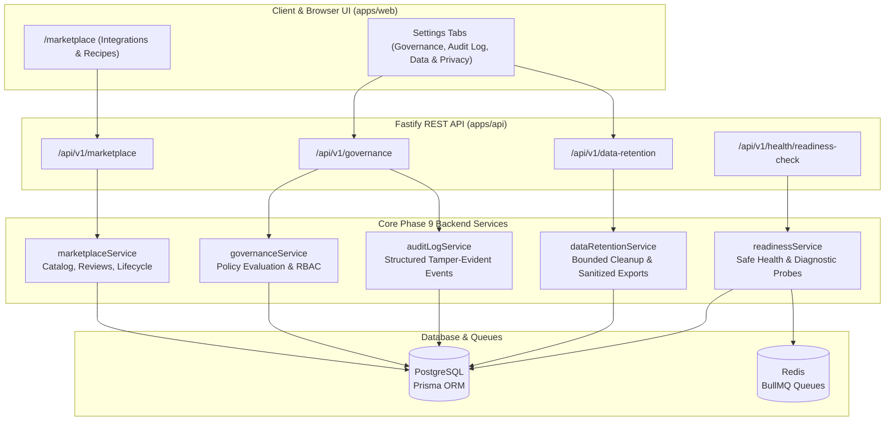

# FlowForge Automation SaaS — Phase 9 Master Implementation Plan
## Integration Marketplace, Community Template Hub, Enterprise Governance, and Production Launch Readiness

### 1. Existing System Baseline & Audit

#### Monorepo Packages
- `@flowforge/database`: Prisma ORM with PostgreSQL client.
- `@flowforge/shared`: Shared types, Zod schemas, plan definitions, developer platform constants.
- `@flowforge/api`: Fastify 4 backend, BullMQ workers (`executions`, `outbound-webhooks`), Redis, Prometheus metrics, Swagger OpenAPI 3.0 documentation.
- `@flowforge/web`: Next.js 14 App Router, React Flow visual editor, Tailwind CSS, TanStack React Query.

#### Verified Baseline Test Results
- **Vitest Integration Tests**: 167 passed / 167 total across 8 test suites (`security`, `integrations`, `execution`, `phase4`, `api`, `billing`, `phase7`, `phase8`).
- **Playwright E2E Browser Tests**: 42 passed / 42 total across 21 user scenarios on Desktop Chrome and Mobile Chrome viewports.

---

### 2. Architecture & Design Requirements

---

### 3. Database Schema Extensions (`packages/database/prisma/schema.prisma`)

1. **`MarketplaceListing`**:
   - Discoverable metadata for both platform-provided and custom community integrations.
   - Fields: `id`, `slug` (unique), `title`, `description`, `category`, `iconName`, `accentColor`, `publisherName`, `publisherWorkspaceId`, `integrationKey`, `customIntegrationId`, `currentVersion`, `visibility` (`PUBLIC`, `WORKSPACE`, `PRIVATE`), `reviewStatus` (`DRAFT`, `IN_REVIEW`, `PUBLISHED`, `REJECTED`, `DEPRECATED`, `UNPUBLISHED`), `rejectionReason`, `capabilities`, `supportedTriggers`, `supportedActions`, `authRequirements`, `documentationUrl`, `createdAt`, `updatedAt`.
2. **`MarketplaceInstallation`**:
   - Tracks tenant installations pinned to specific published versions.
   - Fields: `id`, `workspaceId`, `listingId`, `installedVersion`, `status` (`ACTIVE`, `DISABLED`), `createdAt`, `updatedAt`.
3. **`WorkspaceGovernancePolicy`**:
   - Tenant-level administrative guardrails.
   - Fields: `id`, `workspaceId` (unique), `allowCustomIntegrations` (boolean), `allowMarketplacePublishing` (boolean), `allowCommunityTemplates` (boolean), `requireHttpsWebhooks` (boolean), `maxApiKeyLifetimeDays` (int?), `restrictIntegrationsToAdmin` (boolean), `createdAt`, `updatedAt`.
4. **`WorkspaceRetentionPolicy`**:
   - Tenant data retention configuration.
   - Fields: `id`, `workspaceId` (unique), `executionRetentionDays` (int), `webhookDeliveryRetentionDays` (int), `auditLogRetentionDays` (int), `createdAt`, `updatedAt`.
5. **`DataExportRequest`**:
   - Records for tenant GDPR/CCPA data export requests.
   - Fields: `id`, `workspaceId`, `requestedById`, `status` (`PENDING`, `COMPLETED`, `FAILED`), `downloadUrl`, `fileSizeBytes`, `recordCount`, `expiresAt`, `createdAt`.
6. **`WorkspaceDeletionRequest`**:
   - Multi-step, deliberate workspace deletion workflow.
   - Fields: `id`, `workspaceId`, `requestedById`, `status` (`PENDING`, `CONFIRMED`, `COMPLETED`, `CANCELLED`), `confirmationToken`, `reason`, `scheduledDeletionAt`, `createdAt`.

---

### 4. Implementation Steps & Sequencing

1. **Step 1: Database Schema & Client Compilation**:
   - Update `packages/database/prisma/schema.prisma`.
   - Run `npx prisma db push` and `npx prisma generate`.
   - Build `@flowforge/database`.
2. **Step 2: Shared Types & Validation Schemas (`@flowforge/shared`)**:
   - Add `packages/shared/src/marketplace.ts` & `packages/shared/src/governance.ts`.
   - Update plan features in `packages/shared/src/plans.ts` (governance, retention, marketplace quotas).
   - Build `@flowforge/shared`.
3. **Step 3: Backend Services & API Routes (`apps/api`)**:
   - `services/marketplace.ts`: Catalog querying, listing lifecycle state transitions, review decision recording, version pinning.
   - `services/governance.ts`: Policy inspection and enforcement guards.
   - `services/auditLogs.ts`: Querying paginated audit events, standardized event logging.
   - `services/dataRetention.ts`: Retention policy management, bounded cleanup job, sanitized export bundle generator.
   - `services/readiness.ts`: Automated deployment readiness checker.
   - Routes: `routes/marketplace.ts`, `routes/governance.ts`, `routes/dataRetention.ts`, `routes/readiness.ts`.
   - Register routes in `apps/api/src/server.ts`.
4. **Step 4: Frontend UI Components & Pages (`apps/web`)**:
   - Client API methods in `apps/web/src/lib/api.ts`.
   - Marketplace Page at `apps/web/src/app/marketplace/page.tsx` with Integrations & Template Recipes tabs.
   - Settings page tabs at `apps/web/src/app/settings/page.tsx`:
     - `GovernanceTab.tsx`
     - `AuditLogTab.tsx`
     - `DataPrivacyTab.tsx`
   - Navbar link to `/marketplace`.
   - Build Next.js web application.
5. **Step 5: Automated Test Suite & QA Verification**:
   - Unit & integration tests in `apps/api/test/phase9.test.ts`.
   - E2E browser tests in `e2e/smoke.spec.ts` (Tests 22, 23, 24).
   - Verify 100% green on all suites with zero regressions.
6. **Step 6: Documentation Suite & Completion Report**:
   - Complete operational runbooks, security threat models, and developer guides in `docs/`.
   - Create final artifact `phase9_completion_report.md`.
