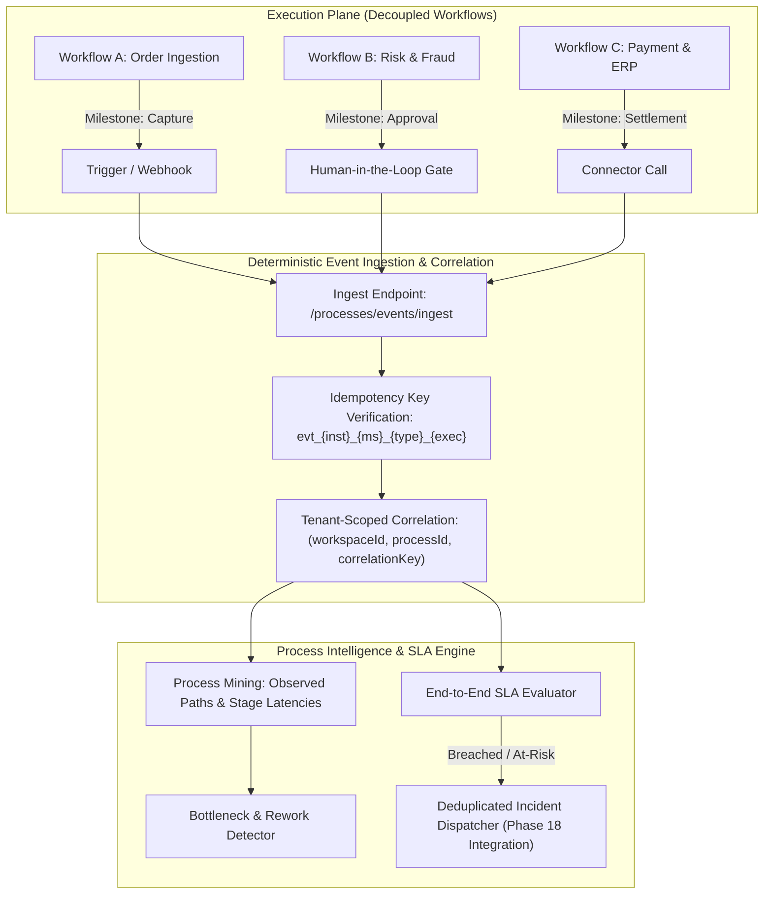

# FlowForge Business Process Intelligence & Process Mining

## 1. Overview & Architecture

FlowForge Business Process Intelligence (Phase 21) enables enterprise organizations to model, track, mine, and optimize end-to-end business outcomes that span multiple decoupled workflows, human approval gates, third-party integrations, and regional execution environments.

Instead of replacing the execution engine, Phase 21 introduces an orchestration intelligence layer on top of FlowForge's durable execution runtime:



---

## 2. Deterministic Correlation & State Transition Engine

Every business process instance is bound to a tenant-scoped correlation key (such as `order_1001` or `customer_9901`).

### Lifecycle States
1. `CREATED`: Instance created upon entry milestone event.
2. `IN_PROGRESS`: Milestone execution started.
3. `WAITING`: Awaiting human review or third-party approval webhook.
4. `AT_RISK`: Instance duration exceeds warning threshold or milestone failed with recoverable retry.
5. `COMPLETED`: Terminal milestone finished or terminal outcome condition satisfied.
6. `FAILED`: Terminal failure reached.
7. `CANCELLED`: Explicitly cancelled by operator or compliance policy.

### Idempotency Standard
Every milestone transition event requires an idempotency key:
`evt_${instanceId}_${milestoneId}_${eventType}_${executionId || 'direct'}`

When a duplicate event arrives (e.g. from retried webhooks or distributed queue re-deliveries), FlowForge returns the existing event without duplicate state progression or metric duplication.

---

## 3. Process Mining & Data Sufficiency Standards

To maintain mathematical integrity and prevent hallucinations, FlowForge enforces a strict **Data Sufficiency Standard**:

| Sample Size | Discovery Status | Behavior |
|:---|:---|:---|
| $< 3$ instances | `INSUFFICIENT_DATA` | Returns empty paths; no bottleneck assertions or synthetic patterns are fabricated. |
| $\ge 3$ instances | `SUFFICIENT` | Extrapolates observed paths, transition frequencies, rework rates, median and P95 durations. |

### Discovered Metrics
- **Observed Paths**: Sequential milestone chains grouped by frequency and percentage of total flow.
- **Rework Rate**: Frequency of instances where a milestone appeared $> 1$ time due to schema validation failures or retries.
- **Stage Waiting Times**: Delineation between active external execution latency vs human approval waiting latency.
- **Bottlenecks**: Flagged when approval wait exceeds 10s, synchronous duration exceeds 25s, or rework loops occur.

---

## 4. End-to-End SLA & Incident Management

Organizations configure target duration SLAs and warning thresholds per process:

```json
{
  "name": "Order-to-Cash Standard SLA",
  "targetDurationMs": 300000,
  "warningThresholdMs": 240000,
  "maxApprovalWaitMs": 60000
}
```

- **Warning Threshold**: Instances reaching `warningThresholdMs` transition to `AT_RISK` status.
- **Breach**: Instances exceeding `targetDurationMs` evaluate as `BREACHED`.
- **Operational Incidents**: Dispatches high-severity incidents via `incidentService` (Phase 18) with deduplication and a 15-minute alert cooldown.

---

## 5. REST API & SDK Usage

### Create Business Process
```typescript
const process = await client.processes.createDefinition({
  name: "Order To Cash",
  slug: "order-to-cash",
  businessDomain: "FINANCE",
  criticality: "MISSION_CRITICAL",
  targetSlaDurationMs: 60000,
  milestones: [
    { id: "m1", name: "Capture", workflowId: "wf-1", order: 1, isEntry: true },
    { id: "m2", name: "Payment", workflowId: "wf-2", order: 2, isTerminal: true },
  ],
});
```

### Ingest Correlated Milestone Event
```typescript
await client.processes.ingestEvent({
  processDefinitionId: process.id,
  correlationKey: "ord_9901",
  milestoneId: "m1",
  eventType: "MILESTONE_STARTED",
  durationMs: 850,
});
```

### Mine Process & Bottlenecks
```typescript
const mining = await client.processes.mine(process.id, 30);
console.log("Sufficiency:", mining.dataSufficiency);
console.log("Observed paths:", mining.observedPaths);
console.log("Bottlenecks:", mining.bottlenecks);
console.log("Recommendations:", mining.recommendations);
```
