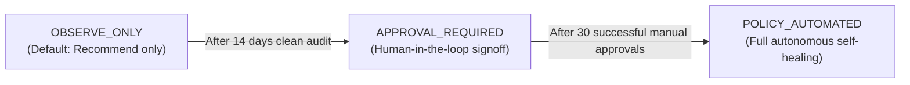

# FlowForge Automation SaaS — Incident Management & Remediation Runbook

## 1. Incident Severity Triage Matrix

When an operational incident is triggered via SLO breach, worker failure, or predictive warning, assess severity according to this matrix:

| Severity | Definition | Impact Scope | Initial Response Target | Remediation Autonomy |
| :--- | :--- | :--- | :--- | :--- |
| **CRITICAL** | Error budget exhausted (0%), authoritative region unreachable, or database connection pool unavailable. | Entire workspace or cluster | Immediate (< 10 mins) | Allowlisted automated recovery or urgent SRE escalation |
| **HIGH** | SLO at risk (< 25% budget remaining), elevated dead-letter outbox count, or recurring step timeouts. | Single workflow or integration | < 30 mins | Automated retry or operator one-click approval |
| **MEDIUM** | Transient rate limiting (HTTP 429), queue drain time deterioration, or single worker lease contention. | Intermittent workflow delays | < 2 hours | Operator review & backpressure throttle |
| **LOW** | Informational capacity warning, baseline drift, or non-impacting retryable anomalies. | Negligible impact | Next business day | Logged for trend analysis |

---

## 2. Standard Incident Lifecycle Handling

### Step 1: Triage & Acknowledgment
1. Open the **Operations** console (`/operations`) or query via SDK `client.incidents.list({ status: "OPEN" })`.
2. Review incident summary, severity, affected workflows, and source service.
3. Acknowledge the incident:
   ```bash
   curl -X POST https://api.flowforge.dev/api/v1/incidents/<incidentId>/status \
     -H "Authorization: Bearer <API_KEY>" \
     -H "Content-Type: application/json" \
     -d '{"status": "ACKNOWLEDGED", "note": "Acknowledged by On-Call SRE"}'
   ```
   *This stops escalation timers and sets `acknowledgedAt` timestamp.*

### Step 2: Automated Root Cause Diagnosis
1. Click **RCA** on the incident row in the UI or invoke:
   ```bash
   curl -X POST https://api.flowforge.dev/api/v1/incidents/<incidentId>/root-cause \
     -H "Authorization: Bearer <API_KEY>"
   ```
2. The assistant inspects recent execution failures, error summaries, and outbox DLQ states.
3. Review candidate hypotheses and supporting evidence in the **Evidence-Backed Root Cause** drawer.

### Step 3: Mitigation & Remediation
Depending on the root cause and suggested action:
- **Upstream Rate Limiting (429)**: Apply concurrency backpressure (`SCALE_CONCURRENCY_BACKPRESSURE`).
- **Dead-Letter Outbox Accumulation**: Trigger outbox replay (`REPLAY_FAILED_OUTBOX_EVENT`).
- **Orphaned / Stalled Executions**: Trigger reconciliation (`REQUEUE_ABANDONED_JOB`).
- **Step Timeouts on Recoverable Workflows**: Trigger execution retry (`RETRY_RETRYABLE_EXECUTION`).
- **Breaking Deployment**: Pause rollout (`PAUSE_FAILING_DEPLOYMENT`).

### Step 4: Resolution & Verification
1. Transition incident to `RESOLVED`:
   ```bash
   curl -X POST https://api.flowforge.dev/api/v1/incidents/<incidentId>/status \
     -H "Authorization: Bearer <API_KEY>" \
     -H "Content-Type: application/json" \
     -d '{"status": "RESOLVED", "note": "Mitigation verified; error budget stabilized"}'
   ```
2. Confirm telemetry returns to `HEALTHY` on the Unified Service Health Scorecard (`/operations`).
3. Transition to `CLOSED` after post-incident review.

---

## 3. Safe Self-Healing Policy Management

### Autonomy Mode Promotion Guide
All workspaces start in `OBSERVE_ONLY` mode by design. Follow this promotion path:



#### Changing Autonomy Mode via API
```bash
curl -X PUT https://api.flowforge.dev/api/v1/remediation/policy \
  -H "Authorization: Bearer <API_KEY>" \
  -H "Content-Type: application/json" \
  -d '{
    "autonomyMode": "APPROVAL_REQUIRED",
    "allowedActions": ["RETRY_RETRYABLE_EXECUTION", "REPLAY_FAILED_OUTBOX_EVENT"],
    "maxAutomatedActionsPerIncident": 3,
    "cooldownMinutes": 15
  }'
```

### Deciding Pending Approvals
When an operation requires approval:
1. Navigate to `/operations` -> **Remediation Operations & Approval Queue**.
2. Inspect target ID, action key, risk level, and parameters.
3. Click **Approve** or **Reject**.
4. The engine executes the action deterministically and performs physical post-action verification.

---

## 4. Emergency Circuit Breakers

If unexpected execution storms, cascade failures, or third-party outages occur:

### 1. Global Workspace Backpressure
Throttles concurrency to 5 slots and tags priority as throttled:
```bash
curl -X POST https://api.flowforge.dev/api/v1/remediation/operations \
  -H "Authorization: Bearer <API_KEY>" \
  -H "Content-Type: application/json" \
  -d '{
    "actionKey": "SCALE_CONCURRENCY_BACKPRESSURE",
    "targetType": "CONCURRENCY",
    "targetId": "workspace"
  }'
```

### 2. Immediate Workflow Rollback / Pause
Deactivates workflow immediately to halt incoming triggers:
```bash
curl -X POST https://api.flowforge.dev/api/v1/remediation/operations \
  -H "Authorization: Bearer <API_KEY>" \
  -H "Content-Type: application/json" \
  -d '{
    "actionKey": "PAUSE_FAILING_DEPLOYMENT",
    "targetType": "WORKFLOW",
    "targetId": "<workflowId>"
  }'
```
