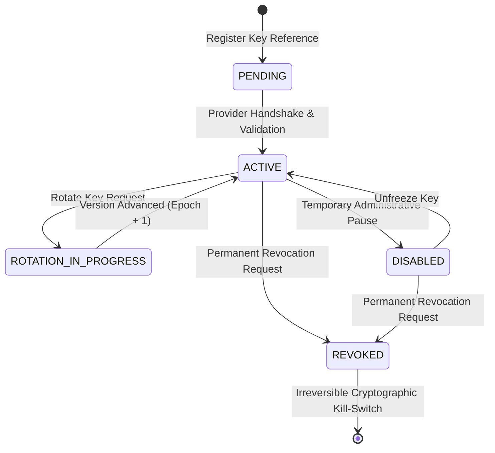

# FlowForge Automation SaaS — Phase 17 CMEK Architecture

## 1. Executive Summary & Principles

Phase 17 introduces enterprise-grade **Customer-Managed Encryption Keys (CMEK)** to FlowForge Automation SaaS. FlowForge protects multi-tenant workflow data by providing tenants cryptographic ownership over their data at rest and in memory.

### Core Architectural Guarantees:
1. **Envelope Encryption**: Data payloads and credentials are encrypted using ephemeral 256-bit Data Encryption Keys (DEKs). DEKs are generated per payload or tenant session, used immediately with AES-256-GCM authenticated encryption, and wrapped using a Key Encryption Key (KEK) owned and controlled by the customer.
2. **KMS Provider Abstraction**: An extensible `KmsProvider` interface allows customer keys to reside in:
   - `LOCAL`: Hardened local master key derivation with simulated envelope wrapping (ideal for on-premise, test environments, and air-gapped deployments).
   - `AWS_KMS`: Native integration with AWS KMS Customer Master Keys (CMKs) via ARN.
   - `VAULT`: HashiCorp Vault Transit engine backend.
3. **Key Versioning & Monotonic Epochs**: Each key rotation generates an immutable `CmekRotationJob`, increments `rotationEpoch`, and records compliance evidence. Data encrypted under older versions remains decryptable via version-tagged envelopes (`keyVersion` token).
4. **Instant Cryptographic Revocation (Kill-Switch)**: Revoking a CMEK immediately prevents any new encryption and locks down decryption of previously encrypted payloads. Because plaintext keys are never persisted, revoking the customer key provides instantaneous, cryptographically unrecoverable data erasure.
5. **Zero-Plaintext Invariants**: Plaintext DEKs and KEKs are never stored in the database, logged to disk, or exposed via public APIs.

---

## 2. Envelope Encryption Wire Format

CMEK-encrypted payloads are stored as colon-delimited tokens:
```
cmek:v1:<base64urlKeyRef>:<keyVersion>:<base64urlWrappedDek>:<ivHex>:<tagHex>:<ciphertextHex>
```

### Token Segments:
- **`cmek:v1`**: Protocol version indicator ensuring safe interoperability with legacy platform standard encryption.
- **`base64urlKeyRef`**: Base64URL-encoded KMS key identifier or ARN.
- **`keyVersion`**: Key version used for wrapping the DEK.
- **`base64urlWrappedDek`**: 256-bit DEK encrypted under the customer's KEK.
- **`ivHex`**: 12-byte initialization vector (96-bit standard for AES-GCM).
- **`tagHex`**: 16-byte authentication tag ensuring ciphertext integrity and tamper detection.
- **`ciphertextHex`**: Hex-encoded encrypted sensitive payload or credential.

---

## 3. Key Lifecycle State Machine



### Key Operations:
- **`registerKey(workspaceId, { keyProvider, keyReference })`**: Validates KMS connectivity, initializes `WorkspaceCmekConfig` with `keyStatus: "ACTIVE"` and `rotationEpoch: 1`, and creates a `ComplianceEvidenceRecord`.
- **`rotateKey(workspaceId, reason)`**: Advances `keyVersion` to $N+1$, increments `rotationEpoch`, spawns a completed `CmekRotationJob`, and records compliance evidence.
- **`revokeKey(workspaceId, reason)`**: Marks key as `REVOKED`. The `decryptWithCmek` and `encryptWithCmek` methods fail closed with `CMEK_KEY_REVOKED`.

---

## 4. Encryption Coverage & Data Classification

| Classification | Typical Resources | CMEK Coverage | Storage Engine |
| :--- | :--- | :--- | :--- |
| **RESTRICTED** | OAuth tokens, API secrets, private keys, database passwords | Envelope Encrypted (AES-256-GCM + KMS KEK) | PostgreSQL `ConnectedAccount`, `ApiKey` |
| **CONFIDENTIAL** | Execution payloads, trigger event payloads, step outputs | Envelope Encrypted if CMEK active | PostgreSQL `WorkflowExecution.triggerEvent` |
| **INTERNAL** | Workflow definitions, node configurations, expressions | Platform AES-256-GCM / CMEK | PostgreSQL `WorkflowVersion.nodes` |
| **PUBLIC** | Template listings, public integration catalogs, usernames | Plaintext | PostgreSQL Public Tables |

---

## 5. Security & Verification Evidence

All CMEK lifecycle operations automatically log tamper-evident `ComplianceEvidenceRecord` rows containing:
- `workspaceId`: Target tenant workspace.
- `evidenceType`: `"CMEK_LIFECYCLE"`.
- `scope`: `"KEY_REGISTRATION"`, `"KEY_ROTATION"`, or `"KEY_REVOCATION"`.
- `checksumSha256`: SHA-256 digest calculated over the action payload.
- `actorId`: User or service principal executing the action.
