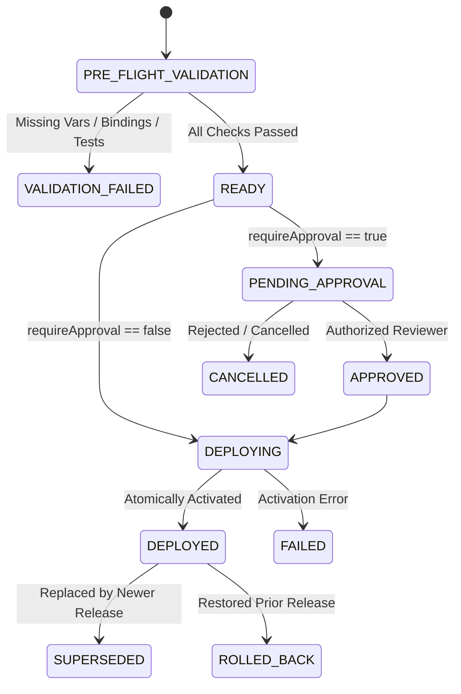

# Release Promotion & Deployment Governance

Comprehensive documentation for FlowForge's workflow deployment promotion lifecycle, pre-flight validation gates, and approval governance.

---

## 1. Deployment State Machine

Deployments transition through explicit, auditable lifecycle states:

---

## 2. Pre-Flight Validation Engine

Before any release artifact can be activated in a target environment:
1. **Artifact Integrity**: Computes SHA-256 hash of canonical definition and verifies it matches `contentHash`.
2. **Environment Variables**: Scans node configuration templates for required `{{env.VAR}}` tokens and verifies that each token exists in the destination environment.
3. **Credential Bindings**: Inspects declared integration keys (`slack`, `github`, `stripe`) and validates that an active `ConnectedAccount` is bound.
4. **Automated Test Gate**: If `requirePassingTests` is enabled for the target environment, verifies that a passed `WorkflowTestRun` exists matching the exact `releaseContentHash`.

---

## 3. Deployment Approvals & Governance

### Production Protection Rules
- **Approval Requirement**: Deployments to protected environments (Production) enter `PENDING_APPROVAL` status.
- **Allowed Roles**: Only users with configured roles (e.g. `OWNER`, `ADMIN`) may approve deployments.
- **Self-Approval Prevention**: The user who initiated the promotion cannot approve their own deployment request (`initiatedByUserId !== approverUserId`).
- **Audit Logging**: Every approval, rejection, and promotion event records the actor, timestamps, and destination environment in `WorkspaceAuditLog`.
